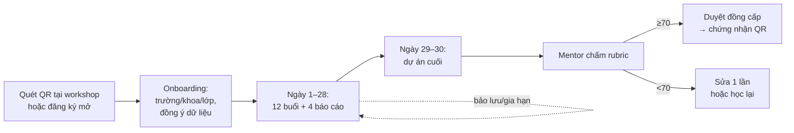

# Phác thảo dự án: Portal tự học AI 30 ngày — AI Campus Tour

> Thiết kế chi tiết chương trình học, module, quy trình xác nhận: xem [`THIET_KE_CHUONG_TRINH.md`](THIET_KE_CHUONG_TRINH.md).

> **v0.2 (26/10/2026)**: cập nhật theo phản hồi của Johnny. Nguồn: `docs/AI_Campus_Tour_PROJECT.md`, đề cương chương trình, kiểm tra trực tiếp suai.vn.
> Quy ước: **[Chốt]** = Johnny đã xác nhận · **[Tài liệu]** = có trong tài liệu · **[Đã kiểm tra]** = Claude đã xem trên hệ thống thật · **[Đề xuất]** = cần chốt · **[Giả định]** = chưa có dữ kiện.

---

## 0. Quyết định đã chốt

| # | Quyết định | Hệ quả thiết kế |
|---|---|---|
| 1 | **Đa trường**: SV nhiều trường học chung trên một hệ thống; **không chia đợt**. Lộ trình 30 ngày tính **từ ngày từng SV đăng ký** | Mỗi SV có lịch riêng; hạn nộp tính theo ngày học thứ N, không theo Chủ nhật cố định |
| 2 | **Con người duyệt toàn bộ**, không dùng AI chấm hay sơ duyệt | Bỏ toàn bộ tính năng AI khỏi phạm vi; tập trung làm công cụ chấm thật nhanh cho mentor |
| 3 | Thương hiệu **AI Campus Tour**; Sự AI là **người sáng lập** | Domain/giao diện mang tên AI Campus Tour; có dòng "Sáng lập bởi Sự AI" |
| 4 | Khóa video chạy trên **Tutor LMS (WordPress, suai.vn)**; lớp trực tuyến qua **meet.suai.vn (Jitsi)** | Tích hợp qua 1 plugin cầu nối trên suai.vn và JWT của Jitsi |
| 5 | Lộ trình dùng **nhiều nguồn học (N1–N11)**; khóa Sự AI chỉ là 1 trong số đó | Có thư viện nguồn học chung; tiến độ tính theo sản phẩm SV nộp, không theo nguồn đã học |
| 6 | **SV đăng ký tự do** (miễn phí), không bắt buộc mã workshop | Mã workshop chỉ dùng để ghi nguồn; cần cơ chế kiểm soát tải chấm |
| 7 | Chứng nhận: SV **trường đã kết nối** → **Trường + Viện ĐT Bách Khoa**; SV trường khác → **Viện ĐT Bách Khoa** | Mẫu chứng nhận có 2 biến thể; cờ "trường đã kết nối" trên School |
| 8 | Tutor LMS **Free**: hoàn thành khóa video → suai.vn **gọi API portal**. Khóa trên meet.suai.vn: **nhân viên portal xác nhận thủ công** | Bỏ SSO/webhook tiến độ từng bài khỏi phạm vi bắt buộc; thêm API nhận hoàn thành khóa + màn xác nhận tay |
| 9 | Domain portal: **aicampustour.suai.vn** · **tự host trên VPS** của Johnny · **file minh chứng lưu Google Drive** | DNS: bản ghi A trỏ về IP VPS; email gửi thông báo từ cùng domain (cần cấu hình SPF/DKIM) |

> Lưu ý: hồ sơ dự án cũ ghi đã chốt tên "AI Ready Campus Tour". Bản này theo quyết định mới là **AI Campus Tour**.

---

## 1. Tóm tắt

Portal **AI Campus Tour** đồng hành với sinh viên trong 30 ngày sau khi đăng ký:

- SV học theo lộ trình 12 buổi, nộp 4 báo cáo tuần và 1 dự án cuối.
- Đội mentor/trợ giảng của Sự AI chấm và hỗ trợ.
- SV đạt sẽ nhận chứng nhận có QR xác thực.
- Giáo viên các trường theo dõi được sinh viên của trường mình.
- Mỗi buổi học gợi ý nhiều nguồn (11 nguồn N1–N11, gồm khóa miễn phí của Anthropic Academy, Microsoft và các công cụ). Khóa Sự AI chỉ là 1 nguồn tùy chọn.
- Portal tích hợp sâu với suai.vn (Tutor LMS) và meet.suai.vn (Jitsi), vì đây là hệ thống của đội.

**3 trụ cột thiết kế:**

1. **Lịch học cá nhân:** đồng hồ 30 ngày chạy riêng cho từng SV; có gia hạn và bảo lưu.
2. **Phân quyền theo trường:** dữ liệu SV gắn với trường; giáo viên chỉ thấy trường/khoa/lớp được gán.
3. **Hàng đợi chấm do người làm:** sắp theo hạn phản hồi, có rubric và mẫu nhận xét, để mỗi bài chấm được trong 2–3 phút.

---

## 2. Vai trò và phân quyền

| Vai trò | Thuộc về | Mô tả |
|---|---|---|
| **Super Admin** | Sự AI | Toàn quyền, cấu hình tích hợp, quản lý admin |
| **Admin vận hành** | Sự AI | Quản lý trường, sự kiện, mã kích hoạt, lộ trình, phân công, gia hạn, cấp/thu hồi chứng nhận |
| **Mentor** | Sự AI | Chấm chính thức báo cáo (Đạt/Cần sửa) và dự án cuối (rubric 100 điểm) |
| **Trợ giảng (TA)** | Sự AI / cộng tác viên | Hỏi đáp, giờ hỗ trợ trực tuyến, nhắc SV chậm tiến độ, kiểm tra hồ sơ trước khi mentor chấm |
| **Quản lý trường** | Trường / Viện ĐT Bách Khoa | Xem toàn bộ SV trường mình, xuất báo cáo, duyệt chứng nhận đồng cấp |
| **Giáo viên trường** | Trường | Xem tiến độ khoa/lớp được gán, động viên SV |
| **Sinh viên** | Trường bất kỳ | Học, tích buổi, nộp bài, hỏi đáp, nhận chứng nhận |
| **Khách** | Công khai | Xem trang xác thực chứng nhận |

> **[Giả định]** Vẫn tách Mentor và TA, vì khối lượng chấm lớn (xem mục 8). Nếu đội bạn chỉ có một loại nhân sự thì gán cả hai role cho cùng một người.
> **[Đề xuất]** Viện ĐT Bách Khoa có tài khoản Quản lý **cấp hệ thống**, xem được mọi trường, vì Viện đồng cấp chứng nhận cho tất cả.

### Ma trận quyền (rút gọn)

| Chức năng | Super Admin | Admin VH | Mentor | TA | QL trường | GV trường | SV |
|---|:-:|:-:|:-:|:-:|:-:|:-:|:-:|
| Quản lý trường, sự kiện, mã kích hoạt | ✅ | ✅ | | | | | |
| Soạn lộ trình, bài học, nguồn học | ✅ | ✅ | đề xuất | | | | |
| Phân công mentor/TA | ✅ | ✅ | | | | | |
| Gia hạn / bảo lưu cho SV | ✅ | ✅ | | đề xuất | | | yêu cầu |
| Xem bài nộp | tất cả | tất cả | SV được gán | SV được gán | trường mình | lớp được gán | của mình |
| Chấm chính thức | | | ✅ | | | | |
| Hỏi đáp, giờ hỗ trợ | | | ✅ | ✅ | | ✅ | ✅ |
| Dashboard tiến độ | toàn hệ thống | toàn hệ thống | SV được gán | SV được gán | trường mình | lớp được gán | cá nhân |
| Xuất báo cáo | ✅ | ✅ | | | ✅ | ✅ | |
| Cấp / thu hồi chứng nhận | ✅ | ✅ | | | duyệt đồng cấp | | tải về |

Phạm vi dữ liệu được áp ở **lớp phân quyền phía server** (mọi truy vấn đều lọc theo phạm vi), có test tự động; không chỉ ẩn ở giao diện.

---

## 3. Mô hình dữ liệu

```mermaid
erDiagram
  SCHOOL ||--o{ FACULTY : has
  FACULTY ||--o{ CLASS : has
  SCHOOL ||--o{ EVENT : "workshop"
  EVENT ||--o{ ACTIVATION_CODE : issues
  PROGRAM_VERSION ||--o{ LESSON : "12 buổi"
  LESSON ||--o{ LESSON_RESOURCE : "N1..N11"
  USER ||--o{ ENROLLMENT : registers
  ENROLLMENT }o--|| PROGRAM_VERSION : "khóa phiên bản"
  ENROLLMENT }o--o| ACTIVATION_CODE : "nguồn"
  ENROLLMENT ||--o{ DEADLINE : "tính từ ngày ĐK"
  ENROLLMENT ||--o{ LESSON_PROGRESS : ticks
  ENROLLMENT ||--o{ SUBMISSION : submits
  SUBMISSION ||--o{ SUBMISSION_VERSION : revisions
  SUBMISSION ||--o{ REVIEW : "người chấm"
  ENROLLMENT ||--o| CERTIFICATE : earns
  ENROLLMENT ||--o{ COURSE_GRANT : "voucher / ghi danh"
  USER ||--o| WP_LINK : "tài khoản suai.vn"
```

| Thực thể | Ghi chú |
|---|---|
| **School / Faculty / Class** | Có cờ **trường đối tác** (đã đăng cai/ký hợp tác) hay không. SV trường chưa đối tác vẫn học được |
| **Event** | Một buổi workshop tại một trường. Dùng để **ghi nguồn** và phát mã, **không** phải đợt học |
| **ActivationCode** | Mã/QR theo sự kiện; có hạn dùng và giới hạn lượt |
| **ProgramVersion / Lesson / LessonResource** | Lộ trình có phiên bản; buổi 7–9 có nhánh A/B/C; mỗi buổi gắn nhiều nguồn từ **ResourceCatalog** (N1–N11, xem 5.0) |
| **Enrollment** | `start_date` = ngày kích hoạt; khối ngành; trạng thái: *đang học / bảo lưu / hoàn thành / quá hạn / bỏ dở*; mentor phụ trách |
| **Deadline** | Sinh tự động khi đăng ký: BC tuần 1–4 vào cuối ngày 7/14/21/28, dự án vào ngày 30. Gia hạn hay bảo lưu thì dời các mốc còn lại |
| **Submission / Version / Review** | Mỗi lần "Cần sửa" tạo một phiên bản mới; review ghi người chấm, kết quả, điểm rubric, nhận xét |
| **Certificate** | Mã số, QR, xếp loại, đơn vị đồng cấp, trạng thái hiệu lực/thu hồi |
| **CourseGrant** | Quyền lợi khóa học: ghi danh miễn phí (20 suất) hoặc mã giảm 50%; trạng thái đồng bộ với suai.vn |
| **WpLink** | Liên kết tài khoản portal ↔ user WordPress trên suai.vn |

### Quy tắc lịch học cá nhân [Đề xuất]

| Quy tắc | Đề xuất |
|---|---|
| Hạn báo cáo | 23:59 ngày 7 / 14 / 21 / 28 tính từ ngày đăng ký; dự án cuối 23:59 ngày 30 |
| Nộp trễ | Vẫn nộp được, có đánh dấu "trễ"; trễ quá 7 ngày cần TA duyệt |
| Gia hạn | Tối đa 1 lần, +7 ngày, SV gửi lý do |
| Bảo lưu | Tối đa 14 ngày (thi cử, thực tập); đồng hồ dừng lại |
| Quá hạn | Quá ngày 30 + gia hạn mà chưa đủ điều kiện → "quá hạn"; được đăng ký học lại từ đầu 1 lần |

> Đề cương cũ ghi hạn "Chủ nhật 23:59". Với lịch cá nhân, hạn chuyển thành "cuối ngày 7/14/21/28". Cần sửa lại đề cương và kịch bản mục 2.6 cho khớp.

---

## 4. Luồng nghiệp vụ chính

### 4.1 Vòng đời một sinh viên



### 4.2 Đăng ký

- **Có mã (từ workshop):** quét QR → form ngắn (họ tên, email, SĐT, MSSV, trường/khoa/lớp, tick đồng ý). Trường được điền sẵn theo sự kiện. Thời điểm tải cao nhất là 300–500 SV quét trong khoảng 5 phút.
- **Đăng ký mở [Đề xuất, cần chốt]:** SV trường chưa có workshop tự đăng ký và chọn trường từ danh sách. Admin bật/tắt được, và có thể giới hạn số lượng để không quá tải mentor.
- Đăng nhập: email OTP hoặc Google. Tài khoản suai.vn được tạo/liên kết tự động khi SV cần vào khóa học (xem mục 5).

### 4.3 Học, nộp bài, chấm (100% người chấm)

1. SV mở buổi học: xem mục tiêu, nguồn học (link thẳng tới bài trên suai.vn hoặc nguồn miễn phí), bài tự luyện.
2. Tích hoàn thành, kèm sản phẩm nhỏ (ảnh/link). **[Đề xuất]** Bắt buộc có minh chứng.
3. Nộp báo cáo tuần theo mẫu 5 trường **[Tài liệu]**.
4. **TA kiểm hồ sơ:** đủ trường chưa, link mở được không. Nếu thiếu thì trả lại ngay, không tốn lượt của mentor.
5. **Mentor chấm:** Đạt/Cần sửa + nhận xét (chọn từ thư viện mẫu, chỉnh lại cho từng bài).
6. SV sửa và nộp lại → quay về hàng đợi, được ưu tiên.

### 4.4 Chứng nhận

- Điều kiện: 12/12 buổi, 4/4 báo cáo Đạt, dự án ≥70/100 **[Tài liệu]**.
- **[Đề xuất]** Dự án ≥90 (Xuất sắc) do 2 mentor chấm chéo, vì kết quả này dùng để giới thiệu SV sang doanh nghiệp.
- **Đơn vị cấp [Chốt]:** SV thuộc **trường đã kết nối** → Trường + Viện ĐT Bách Khoa (Quản lý trường duyệt theo lô). SV trường khác → Viện ĐT Bách Khoa.
- Trang xác thực công khai `/verify/{mã}`: tên SV, trường, đơn vị cấp, ngày cấp, xếp loại, tên dự án (SV chọn có hiện link dự án hay không).

---

## 5. Nguồn học và tích hợp

### 5.0 Thư viện nguồn học (đa nguồn)

Lộ trình 30 ngày dùng **11 nguồn học (N1–N11)** **[Tài liệu: Đề cương, mục 4]**. Khóa Sự AI (N1) chỉ là **một trong số đó**. Mỗi kiến thức có ít nhất 2 nơi học, và SV chỉ cần chọn 1 nguồn.

| Mã | Nguồn | Loại | Buổi | Mức tích hợp |
|---|---|---|---|---|
| N1 | Khóa Ứng dụng AI cho văn phòng – Sự AI (video / trực tuyến) | Khóa học (tiếng Việt) | 1–9, 11 | **Sâu**: deep link, SSO, ghi danh, voucher, đồng bộ tiến độ (5.1–5.3) |
| N2 | AI Fluency for Students – Anthropic Academy | Khóa học miễn phí (EN) | 1 | Link + SV tự xác nhận |
| N3 | AI Capabilities and Limitations – Anthropic Academy | Khóa học miễn phí (EN) | 1 | Link + SV tự xác nhận |
| N4 | AI Fluency: Framework & Foundations – Anthropic Academy | Khóa học miễn phí (EN) | 2 | Link + SV tự xác nhận |
| N5 | Claude 101 – Anthropic Academy | Khóa học miễn phí (EN) | 3 | Link + SV tự xác nhận |
| N6 | ChatGPT / Gemini chế độ giọng nói | Công cụ | 6 | Link + hướng dẫn dùng |
| N7 | LinkedIn, TopCV, VietnamWorks | Nền tảng tuyển dụng | 4, 5, 12 | Link |
| N8 | Kaggle Datasets | Dữ liệu mẫu | 7, 8 | Link (có thể gợi ý sẵn bộ dữ liệu cho từng khối) |
| N9 | Introduction to agent skills – Anthropic Academy | Khóa học miễn phí (EN) | 9, 11 | Link + SV tự xác nhận |
| N10 | NotebookLM, Perplexity | Công cụ kiểm chứng | 2 (mọi buổi) | Link + hướng dẫn dùng |
| N11 | Generative AI for Beginners (Microsoft) | Khóa mã nguồn mở, có bản tiếng Việt | 7–9, 11 (khối C) | Link tới bài cụ thể |

**Thiết kế:**
- **ResourceCatalog** là danh mục nguồn chung, Admin quản lý gồm: mã, tên, loại, nhà cung cấp, ngôn ngữ, chi phí, URL. Mỗi buổi gắn **nhiều** nguồn, có thứ tự gợi ý. Thay hay thêm nguồn không phải sửa code.
- Màn buổi học hiển thị các nguồn **ngang hàng**; SV chọn nguồn mình học và ghi lại lựa chọn (dùng để thống kê nguồn nào được chọn nhiều).
- Tiến độ chỉ dựa trên **sản phẩm tự luyện mà SV nộp**, không phụ thuộc việc SV học nguồn nào. Nhờ vậy SV học nguồn miễn phí vẫn hoàn thành đủ, không bị thiệt so với người học khóa Sự AI.
- Với nguồn bên ngoài (Anthropic Academy, Microsoft…), portal **không tích hợp API** được: chỉ có link, SV tự xác nhận và có thể đính kèm ảnh/chứng chỉ hoàn thành.
- **Kiểm tra link định kỳ** (job hằng tuần báo link hỏng cho Admin), vì đề cương có lưu ý "kiểm tra lại link trước khi in".
- Tích hợp sâu (5.1–5.3) chỉ áp dụng cho suai.vn và meet.suai.vn, vì đây là hệ thống của đội. Lý do là khả năng kỹ thuật, không phải ưu tiên N1 về nội dung.

### 5.1 Hiện trạng suai.vn [Đã kiểm tra]

| Khóa trên Tutor LMS | ID | Liên quan portal |
|---|---|---|
| Khóa học AI cho văn phòng (Học online qua Video) | 3584 | **N1 bản video**: link bài học, 20 suất miễn phí, mã giảm 50% |
| Khóa học AI văn phòng (Học online qua Zoom) | 3599 | **N1 bản trực tuyến** (học trên meet.suai.vn): mã giảm 50% |
| Khóa tạo Video bằng AI (Zoom) · Vibe code · n8n (lớp tại Bình Tân) | 3709, 3597, 3598 | Gợi ý học tiếp sau khi hoàn thành |

Bài học có URL ổn định dạng `/courses/khoa-hoc-ai-cho-van-phong-online/lessons/{slug}/`, nên link thẳng từ buổi học sang đúng bài được ngay.

### 5.2 Plugin cầu nối `aict-bridge` trên suai.vn [Đề xuất]

Đây là một plugin WordPress nhỏ do đội tự viết, nói chuyện với portal qua API có ký HMAC. Chọn cách này thay vì phụ thuộc REST API của Tutor (bản Free/Pro khác nhau và dễ đổi giữa các phiên bản).

| Chức năng | Chiều | Cách làm |
|---|---|---|
| **Tạo/liên kết tài khoản** | Portal → WP | Tìm user theo email; chưa có thì tạo. Trả về `wp_user_id` |
| **Đăng nhập 1 chạm (SSO)** | Portal → WP | Portal sinh token ký, hạn 60 giây → `suai.vn/?aict_sso=…` → plugin xác thực, đăng nhập rồi chuyển tới đúng bài học |
| **Ghi danh miễn phí** (20 suất) | Portal → WP | Plugin gọi hàm ghi danh của Tutor cho khóa 3584. **Không cần mã giảm giá** |
| **Mã giảm 50%** | Portal → WP | Tạo coupon dùng 1 lần cho từng SV, qua hệ thống bán hàng đang dùng (WooCommerce hoặc thanh toán sẵn của Tutor, **cần xác nhận**) |
| **Đồng bộ tiến độ** | WP → Portal | Hook hoàn thành bài học của Tutor → webhook về portal. Portal hiện "Đã học bài X trên suai.vn" và gợi ý tích buổi tương ứng; SV vẫn phải nộp sản phẩm |
| **Đồng bộ mua khóa** | WP → Portal | Đơn hàng hoàn tất → ghi nhận chuyển đổi để đo hiệu quả voucher |

> Tên hook/hàm của Tutor phải kiểm lại theo đúng phiên bản đang cài trên suai.vn trước khi code.

### 5.3 meet.suai.vn (Jitsi)

| Nhu cầu | Cách làm |
|---|---|
| **Giờ hỗ trợ trực tuyến cho SV portal** [Đề xuất] | TA/mentor mở phòng cố định (vd. tối thứ 3 và thứ 6) để SV hỏi trực tiếp. Lịch hiển thị trên portal |
| **Chỉ người được phép mới vào** | Bật **xác thực JWT** của Jitsi (Prosody token auth). Portal sinh JWT gồm: phòng, tên hiển thị, quyền moderator (mentor/TA) |
| **Vào phòng** | Nút "Tham gia" mở meet.suai.vn kèm JWT, hoặc nhúng ngay trong portal bằng Jitsi IFrame API |
| **Điểm danh** | Mức 1: ghi sự kiện vào/ra phòng từ IFrame API. Mức 2: module event_sync của Prosody đẩy webhook về portal (tin cậy hơn) |
| **Lớp N1 bản trực tuyến** | Nếu lớp trả phí cũng chạy trên meet.suai.vn, có thể dùng chung cơ chế JWT để chỉ học viên đã mua mới vào được |

> **[Giả định]** Chưa biết meet.suai.vn đã bật JWT hay đang mở tự do (môi trường này không truy cập được meet.suai.vn để kiểm tra). Bật JWT là việc cấu hình phía server.

### 5.4 Nguyên tắc trình bày

N1 là **một nguồn tùy chọn** **[Tài liệu]**, hiển thị ngang hàng với các nguồn miễn phí và không phải điều kiện hoàn thành. Như vậy portal giữ được hình ảnh dự án cộng đồng của AI Campus Tour.

---

## 6. Thông báo và nhắc nhở

Mọi mốc đều tính theo lịch cá nhân của SV.

| Sự kiện | Kênh | Người nhận |
|---|---|---|
| Đăng ký thành công, mở buổi mới | In-app, email | SV |
| Còn 24h tới hạn báo cáo | Email, Zalo | SV |
| Trễ hạn hoặc **7 ngày không tích buổi nào** [Tài liệu] | Email, Zalo; 10 ngày thì báo TA | SV, TA |
| Bài được chấm / cần sửa | In-app, email | SV |
| Bài chờ chấm sắp quá hạn phản hồi | In-app | Mentor, Admin |
| Nhắc giờ hỗ trợ trực tuyến | Email, Zalo | SV đăng ký tham gia |
| Báo cáo tiến độ hằng tuần | Email | QL trường, GV |
| Đạt chứng nhận | Email, Zalo | SV |

Kênh Zalo: Zalo OA + ZNS. Mẫu tin phải được duyệt và **tính phí theo tin** [cần kiểm tra giá hiện hành].
**[Đề xuất]** Portal bắn webhook sự kiện, **n8n** lo gửi email/Zalo. Đổi nội dung hay kênh gửi không cần sửa code.

---

## 7. Màn hình theo vai trò

| Vai trò | Màn hình chính |
|---|---|
| **SV** | Trang chủ (ngày thứ N/30, buổi tiếp theo, hạn gần nhất) · Lộ trình 12 buổi · Nộp báo cáo · Dự án · Hỏi đáp & giờ hỗ trợ · Khóa học & voucher · Chứng nhận · Yêu cầu gia hạn/bảo lưu |
| **Mentor** | Hàng đợi chấm (sắp theo hạn phản hồi, lọc theo loại bài/khối ngành) · Màn chấm (bài + rubric + thư viện nhận xét + lịch sử phiên bản) · SV phụ trách |
| **TA** | Hàng đợi kiểm hồ sơ · Hỏi đáp · Danh sách SV có nguy cơ bỏ dở · Lịch giờ hỗ trợ |
| **GV / QL trường** | Dashboard theo khoa/lớp (đăng ký, đang học, % hoàn thành, đạt) · Danh sách SV · Duyệt chứng nhận · Xuất Excel/PDF |
| **Admin** | Trường & sự kiện & mã · Lộ trình & phiên bản · Phân công · Gia hạn/bảo lưu · Quyền lợi khóa học · Tích hợp · Nhật ký · Báo cáo toàn hệ thống |
| **Công khai** | Trang giới thiệu AI Campus Tour (ghi "Sáng lập bởi Sự AI") · Đăng ký · Xác thực chứng nhận |

Yêu cầu chung: **mobile-first**, tiếng Việt, chạy tốt trên 4G.

### Công cụ giúp mentor chấm nhanh (thay cho AI)

- Rubric dạng checklist: bấm chọn, điểm tự cộng.
- Thư viện nhận xét mẫu theo từng buổi/lỗi hay gặp, chèn bằng phím tắt.
- Xem bài ngay trong trang, không phải tải file.
- Phím tắt Đạt / Cần sửa / bài tiếp theo.
- Phân bài tự động cho mentor theo khối ngành và tải hiện tại.

---

## 8. Tải chấm bài (vẫn là rủi ro lớn nhất)

Không chia đợt **không làm mất đỉnh tải**: 500 SV từ cùng một workshop vẫn đăng ký cùng ngày, nên cùng nộp báo cáo tuần 1 vào ngày 7.

**[Giả định]** 1 workshop có 500 SV đăng ký, 50% theo tới cuối, 20% bài bị yêu cầu sửa:

| | Số lượt |
|---|---|
| Báo cáo tuần (giảm dần 500 → 250) | ~1.500 |
| Chấm lại | ~300 |
| Dự án cuối | ~250 |
| **Tổng / workshop** | **~2.000 lượt** |

- Chấm 3 phút/bài (đã có công cụ ở mục 7) → **~100 giờ/workshop**.
- Riêng **ngày 7–10** sau workshop có ~500 bài, tức ~25 giờ chấm dồn trong 3 ngày → cần **3–4 người** nếu muốn giữ hạn phản hồi ≤3 ngày.
- Mùa cao điểm 2 workshop/tháng → ~200 giờ/tháng, tương đương **khoảng 1,2 người làm toàn thời gian**.

→ Đề xuất:
- TA lọc hồ sơ thiếu trước khi đến tay mentor.
- Có danh sách mentor cộng tác theo giờ cho các đợt dồn bài.
- Đưa chi phí chấm vào gói tài trợ.
- Đặt trần số SV đăng ký mở mỗi tuần.

---

## 9. Kiến trúc kỹ thuật

### 9.1 Khuyến nghị: portal riêng, tự host trên VPS [Chốt: deploy lên VPS của Johnny]

| Lớp | Lựa chọn | Lý do |
|---|---|---|
| Web + API | **Next.js (App Router, TypeScript)**, Tailwind, shadcn/ui; build ở chế độ `standalone` | Một codebase cho SV, nhân sự, trường, trang công khai; chạy gọn trong Docker |
| Database | **PostgreSQL 16** (container) + **Drizzle ORM** | Dữ liệu quan hệ, migration có kiểm soát |
| Phân quyền | Lớp phân quyền tập trung trong code (mọi truy vấn đều lọc theo trường/lớp/người được gán) + test tự động cho ma trận quyền | Không có Supabase thì RLS kém tiện; tập trung một chỗ dễ kiểm tra hơn |
| Auth | **Better Auth**: email OTP/magic link, Google | Tự host, không phụ thuộc dịch vụ ngoài |
| Email | SMTP (dịch vụ gửi mail giao dịch hoặc mail server sẵn có) từ `@aicampustour.suai.vn` hoặc `@suai.vn` | Cần cấu hình SPF/DKIM để không vào spam |
| File minh chứng | **Google Drive** [Chốt] qua Drive API, sau lớp `StorageProvider`. Chi tiết ở mục 9.2 | Không tốn ổ VPS; đội quen dùng Drive |
| Job nền | Worker Node chạy lịch (tính hạn, đánh dấu quá hạn, kiểm tra link) + **n8n** (gửi email/Zalo) | Nhắc nhở theo lịch cá nhân |
| Reverse proxy | **Caddy** (HTTPS tự động) | Cấp chứng chỉ SSL cho `aicampustour.suai.vn` |
| Triển khai | **Docker Compose** · GitHub Actions build image → GHCR → SSH vào VPS chạy `docker compose pull && up -d` | Deploy 1 lệnh, rollback được |
| Sao lưu | `pg_dump` hằng ngày + thư mục file → đẩy ra **ngoài VPS** (Google Drive/S3), giữ 14 bản | VPS hỏng không mất dữ liệu SV |
| Giám sát | Uptime check (vd. Uptime Kuma) + log; Sentry (tùy chọn) | Bắt lỗi lúc tải cao khi kích hoạt |
| Tích hợp | `aict-bridge` (PHP) trên suai.vn; JWT cho meet.suai.vn | Xem mục 5 |

**Lưu ý về VPS [Đề xuất]:**
- **Không nên chạy chung với Jitsi** (meet.suai.vn): Jitsi ngốn CPU và băng thông khi có lớp, có thể làm portal chậm đúng lúc SV nộp bài. Chạy chung với WordPress/n8n thì được nếu đủ RAM.
- Cấu hình tối thiểu gợi ý cho portal: 2 vCPU, 4 GB RAM, 40 GB SSD (giả định, sẽ điều chỉnh theo số SV thực tế).
- Thời điểm tải cao nhất là 300–500 SV kích hoạt trong ~5 phút. Cần chạy thử tải trước workshop đầu.

### 9.2 Lưu file minh chứng trên Google Drive [Chốt hướng, chi tiết là Đề xuất]

**SV nộp bằng 2 cách:**

| Cách nộp | Áp dụng | Cách xử lý |
|---|---|---|
| **Dán link** (Google Docs/Sheets/Slides/Drive, Canva, GitHub, link deploy…) | Mặc định cho hầu hết bài | Portal kiểm tra link mở được không; nhắc SV đặt quyền "Bất kỳ ai có đường liên kết – Người xem" |
| **Tải file lên portal** (ảnh chụp, .xlsx, .docx, .pdf; tối đa 10 MB) | Ảnh minh chứng, file không có sẵn link | Portal đẩy file vào **Drive của dự án**, lưu `fileId`, không lưu file trên VPS |

**Cấu trúc thư mục trên Drive:** `AI Campus Tour / <Trường> / <MSSV – Họ tên> / <M1…M5> / <buổi>_<tên file>`

**Quyền truy cập:**
- File do portal tải lên **không bật chia sẻ công khai**.
- Mentor, TA, GV xem file **qua portal**: portal kiểm tra quyền rồi lấy file từ Drive trả về. GV trường không cần tài khoản Google, và không ai nhìn thấy cả kho.
- Chỉ Admin truy cập thẳng thư mục Drive.

**Chống sửa bài sau khi đã chấm:**
- File tải lên portal thì SV không sửa được, vì portal là chủ sở hữu.
- Với bài nộp dạng link, khi mentor bấm "Đạt", portal lưu lại thời điểm sửa cuối của file (nếu đọc được). **Dự án cuối bắt buộc tải bản PDF lên** để lưu bằng chứng cố định cho trang xác thực chứng nhận.

**Điều kiện kỹ thuật (cần chốt):**

| Phương án | Cần gì | Lưu ý |
|---|---|---|
| **A. Shared Drive (Google Workspace)** (khuyến nghị) | Gói Workspace có Shared Drive + service account | Dung lượng dùng chung của tổ chức; không phụ thuộc tài khoản cá nhân; nhân sự nghỉ không mất dữ liệu |
| **B. Drive cá nhân** | Một tài khoản Google + OAuth (refresh token) | Service account **không có dung lượng riêng**, nên phải ghi vào Drive của người thật. Gói miễn phí chỉ 15 GB, sẽ phải mua thêm Google One |

**Ước tính dung lượng [Giả định]:** 10.000 SV/năm × ~5 file tải lên × ~1 MB ≈ **50 GB/năm**. Nếu khuyến khích nộp link tốt thì ít hơn nhiều.

**Pháp lý:** file minh chứng có dữ liệu cá nhân (CV, ảnh). Lưu trên Google, tức máy chủ ở nước ngoài, là **chuyển dữ liệu cá nhân ra nước ngoài**. Cần ghi rõ trong điều khoản đồng ý của SV và hỏi tư vấn pháp lý về hồ sơ cần lập theo quy định bảo vệ dữ liệu cá nhân hiện hành.

### 9.3 Phương án thay thế: dựng luôn trên Tutor LMS

Tutor LMS (bản Pro) đã có sẵn assignment, chứng chỉ, mở bài theo ngày đăng ký (content drip) và báo cáo. Vì vậy phương án này đáng cân nhắc nếu thời gian rất gấp.

| | Portal riêng | Dựng trên Tutor LMS |
|---|---|---|
| Thời gian ra bản đầu | Lâu hơn | **Nhanh hơn** |
| Tài khoản SV | Portal + liên kết suai.vn | **Một tài khoản suai.vn** |
| Phân quyền GV theo trường/khoa/lớp | **Làm chuẩn được** | Phải code PHP tùy biến nhiều |
| Hàng đợi chấm, hạn phản hồi, vai trò TA | **Làm chuẩn được** | Rất hạn chế |
| Dashboard cho trường, chứng nhận đồng cấp + QR verify | **Làm chuẩn được** | Phải tùy biến |
| Thương hiệu AI Campus Tour tách khỏi Sự AI | **Tách rõ** | Nằm trong suai.vn → trái nguyên tắc thương hiệu |
| Tải hệ thống lúc 500 SV kích hoạt cùng lúc | Ổn (cần chạy thử tải) | WordPress cần tối ưu cache |

→ **Chọn portal riêng.** Lý do chính: phân quyền theo trường, quy trình chấm do người làm, và thương hiệu AI Campus Tour tách khỏi Sự AI là 3 yêu cầu cốt lõi mà Tutor làm yếu.

### 9.4 Khung repo

```
apps/web/                 # Next.js: (public) (student) (staff) (school) (admin)
packages/db/              # schema Drizzle, migrations, seed lộ trình 12 buổi
deploy/                   # docker-compose, Caddyfile, script backup
packages/integrations/    # tutor-bridge client, jitsi-jwt, notify-webhook
wordpress/aict-bridge/    # plugin cầu nối cài trên suai.vn
docs/
```

---

## 10. Bảo mật và tuân thủ

- **NĐ 13/2023:** có màn đồng ý khi đăng ký. Đồng ý chia sẻ hồ sơ với doanh nghiệp/nhà tài trợ là mục riêng, mặc định **không**. Có chức năng xuất và xóa dữ liệu theo yêu cầu.
- Chỉ đồng bộ sang suai.vn những gì cần (email, tên) và **chỉ khi SV bấm vào khóa học**. Điều này phải ghi rõ trong điều khoản.
- Mọi truy vấn dữ liệu SV đi qua lớp phân quyền phía server, có test tự động cho ma trận quyền; ghi audit log khi xuất dữ liệu, cấp/thu hồi chứng nhận, gia hạn, đổi quyền.
- Cầu nối WP: ký HMAC, chống replay (timestamp + nonce), giới hạn IP nếu được. Secret của JWT Jitsi chỉ lưu ở server.
- Mã chứng nhận khó đoán; trang verify không lộ email/SĐT.
- Sao lưu hằng ngày; staging tách khỏi production.

---

## 11. Lộ trình triển khai

| Giai đoạn | Phạm vi | Hạn |
|---|---|---|
| **P0 – Chạy được workshop đầu** | Đăng ký bằng mã/QR · Lịch cá nhân 30 ngày · 12 buổi (nhánh A/B/C) + link nguồn học (gồm deep link bài Tutor) · Tích buổi · Nộp báo cáo · Mentor chấm Đạt/Cần sửa · Dashboard trường cơ bản · Nhắc hạn qua email · Admin trường/sự kiện/mã | Trước workshop ĐH Công Thương (**ngày chưa chốt**) |
| **P1 – Hoàn tất vòng 30 ngày** | Dự án + rubric · Chứng nhận PDF/QR + trang verify · Duyệt đồng cấp · Vai trò TA + hàng đợi kiểm hồ sơ · Gia hạn/bảo lưu · Xuất báo cáo · `aict-bridge`: tạo tài khoản + ghi danh 20 suất miễn phí | Trước **ngày 28 kể từ workshop đầu** |
| **P2 – Vận hành nhiều trường** | SSO sang suai.vn · Mã giảm 50% · Webhook tiến độ Tutor · Jitsi JWT + giờ hỗ trợ + điểm danh · Zalo ZNS · Đăng ký mở · Thư viện nhận xét, phân bài tự động | Trước mùa cao điểm (T3/2027) |
| **P3 – Mở rộng** | Cổng nhà tài trợ · Kho hồ sơ SV Xuất sắc (có đồng ý) · PWA/thông báo đẩy · Phân tích xuyên trường | Năm 2 |

---

## 12. KPI

| Nhóm | Chỉ số |
|---|---|
| Phễu SV | Tham dự → đăng ký → hoạt động ngày 7 → nộp BC tuần 4 → nộp dự án → đạt chứng nhận (theo trường, theo sự kiện) |
| Chất lượng | % Xuất sắc, điểm rubric trung bình, % bài "Cần sửa" |
| Vận hành | Thời gian phản hồi trung bình, % bài chấm đúng hạn, số bài/mentor/ngày |
| Trường | Số trường đối tác, số trường mời lại, số SV đăng ký mở theo trường |
| Khóa học | Suất miễn phí đã dùng, mã 50% đã dùng, đơn hàng phát sinh trên suai.vn |

---

## 13. Câu hỏi còn mở

| # | Câu hỏi | Ảnh hưởng |
|---|---|---|
| 1 | Có cho **đăng ký mở** (không cần mã workshop) không? Có giới hạn số lượng không? | Tải chấm, phạm vi P0 |
| 2 | ~~Chứng nhận cho SV trường chưa kết nối~~ | Đã chốt: Viện ĐT Bách Khoa cấp |
| 3 | Có tách Mentor và TA không? Đội ngũ chấm dự kiến bao nhiêu người? | Phân quyền, hạn phản hồi cam kết |
| 4 | suai.vn bán khóa qua **WooCommerce** hay **thanh toán sẵn của Tutor**? Tutor đang dùng bản Free hay Pro, phiên bản nào? | Cách tạo mã giảm 50%, hook đồng bộ |
| 5 | meet.suai.vn đã bật xác thực JWT chưa? Ai quản trị server Jitsi? | Kiểm soát vào phòng, điểm danh |
| 6 | Giáo viên trường chỉ xem, hay được nhận xét bài? | Phân quyền |
| 7 | Quy tắc gia hạn/bảo lưu ở mục 3 có ổn không? | Logic lịch cá nhân |
| 8 | ~~Domain portal~~ | Đã chốt: aicampustour.suai.vn |
| 9 | Ngày workshop đầu tiên | Hạn P0 |
| 10 | Ai phát triển (bạn tự build cùng Claude hay thuê đội) và ngân sách hạ tầng/tháng? | Phạm vi P0, lựa chọn dịch vụ |
