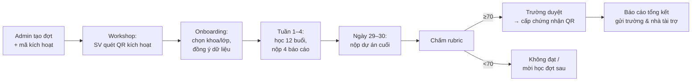

# Phác thảo dự án: Portal tự học AI 30 ngày

> Bản phác thảo v0.1 (26/10/2026), dựa trên `docs/AI_Campus_Tour_PROJECT.md` và đề cương chương trình.
> Quy ước: **[Tài liệu]** = có trong tài liệu dự án · **[Đề xuất]** = Claude đề xuất, cần chốt · **[Giả định]** = chưa có dữ kiện.

---

## 0. Tóm tắt

Portal là **nền tảng đồng hành 30 ngày sau workshop**: sinh viên học theo lộ trình 12 buổi, nộp báo cáo, được đội ngũ mentor/trợ giảng chấm và hỗ trợ, rồi nhận chứng nhận có QR xác thực. Trường xem tiến độ sinh viên của mình. Portal kết nối với các khóa học của Sự AI (video, Zoom) để làm nguồn học và cấp voucher.

**3 điểm thiết kế cốt lõi:**

1. **Đa trường (multi-tenant):** mỗi trường là một không gian riêng. Giáo viên trường A không thấy dữ liệu của trường B.
2. **Theo đợt (cohort):** mỗi workshop tạo một đợt, có lịch 30 ngày riêng và mã kích hoạt riêng.
3. **Chấm bài có tầng:** AI sơ duyệt → trợ giảng → mentor quyết định. Không có tầng này thì đội mentor sẽ bị quá tải (xem mục 9).

---

## 1. Mục tiêu và phạm vi

| Mục tiêu | Đo bằng |
|---|---|
| SV hoàn thành lộ trình, có sản phẩm thật để ghi vào CV | % SV đạt chứng nhận / SV kích hoạt |
| Nhà trường thấy giá trị và mời tour quay lại | Dashboard tiến độ theo lớp/khoa, báo cáo tổng kết đợt |
| Chứng nhận đáng tin với nhà tuyển dụng | Trang xác thực QR công khai |
| Tạo kênh dẫn tới khóa học Sự AI (tùy chọn, không bắt buộc) | Số voucher đã dùng, tỷ lệ chuyển đổi |
| Vận hành được 15–20 trường/năm với đội ngũ nhỏ | Thời gian chấm trung bình, số bài mỗi mentor chấm/ngày |

**Không thuộc phạm vi (giai đoạn đầu):** tự host video bài giảng (đã có nền tảng khóa học riêng), mạng xã hội/diễn đàn đầy đủ, app native.

---

## 2. Vai trò và phân quyền

### 2.1 Danh sách vai trò

| Vai trò | Thuộc về | Mô tả |
|---|---|---|
| **Super Admin** | Sự AI | Toàn quyền hệ thống, cấu hình tích hợp, quản lý admin |
| **Admin vận hành** | Sự AI | Tạo trường, đợt, mã kích hoạt; phân công mentor/TA; cấp/thu hồi chứng nhận |
| **Mentor** | Sự AI | Chấm chính thức báo cáo (Đạt/Cần sửa) và dự án cuối (rubric 100 điểm) |
| **Trợ giảng (TA)** | Sự AI hoặc cộng tác viên | Trả lời hỏi đáp, sơ chấm, nhắc SV chậm tiến độ; không quyết định kết quả cuối |
| **Quản lý trường** | Trường / Viện ĐT Bách Khoa | Xem toàn bộ trường mình, xuất báo cáo, duyệt ký chứng nhận đồng cấp |
| **Giáo viên trường** | Trường | Xem tiến độ các lớp/khoa được gán; có thể nhận xét, khuyến khích SV |
| **Sinh viên** | Trường | Học, tích buổi, nộp bài, hỏi đáp, nhận chứng nhận |
| **Nhà tài trợ** [Đề xuất, P3] | Doanh nghiệp | Xem số liệu tổng hợp ẩn danh; xem hồ sơ SV Xuất sắc **chỉ khi SV đồng ý** |
| **Khách (nhà tuyển dụng)** | Công khai | Không cần tài khoản; chỉ xem trang xác thực chứng nhận |

> **[Giả định]** Phân biệt Mentor và TA như trên. Nếu đội bạn không tách hai vai trò này thì gộp lại; hệ thống vẫn nên giữ 2 role để sau này mở rộng.

### 2.2 Ma trận quyền (rút gọn)

| Chức năng | Super Admin | Admin VH | Mentor | TA | QL trường | GV trường | SV |
|---|:-:|:-:|:-:|:-:|:-:|:-:|:-:|
| Quản lý trường, đợt, mã kích hoạt | ✅ | ✅ | | | | | |
| Soạn/sửa lộ trình, bài học, nguồn học | ✅ | ✅ | đề xuất | | | | |
| Phân công mentor/TA cho đợt | ✅ | ✅ | | | | | |
| Xem bài nộp | ✅ | ✅ | đợt được gán | đợt được gán | trường mình | lớp được gán | của mình |
| Sơ chấm, gợi ý nhận xét | | | ✅ | ✅ | | | |
| Chấm chính thức (Đạt/Cần sửa, rubric) | | | ✅ | | | | |
| Trả lời hỏi đáp | | | ✅ | ✅ | | ✅ | |
| Dashboard tiến độ | toàn hệ thống | toàn hệ thống | đợt được gán | đợt được gán | trường mình | lớp được gán | cá nhân |
| Xuất báo cáo Excel/PDF | ✅ | ✅ | | | ✅ | ✅ | |
| Cấp / thu hồi chứng nhận | ✅ | ✅ | | | duyệt đồng cấp | | tải về |
| Cấu hình tích hợp (khóa học, Zoom, Zalo) | ✅ | | | | | | |

Phạm vi dữ liệu được áp ở **tầng database** (Row Level Security), không chỉ ẩn ở giao diện.

---

## 3. Cấu trúc tổ chức và mô hình dữ liệu

```mermaid
erDiagram
  SCHOOL ||--o{ FACULTY : has
  FACULTY ||--o{ CLASS : has
  SCHOOL ||--o{ COHORT : hosts
  PROGRAM ||--o{ PROGRAM_VERSION : versions
  PROGRAM_VERSION ||--o{ LESSON : "12 buổi"
  LESSON ||--o{ LESSON_RESOURCE : "N1..N11"
  COHORT }o--|| PROGRAM_VERSION : uses
  COHORT ||--o{ ACTIVATION_CODE : issues
  COHORT ||--o{ STAFF_ASSIGNMENT : "mentor/TA"
  USER ||--o{ ENROLLMENT : joins
  COHORT ||--o{ ENROLLMENT : contains
  ENROLLMENT ||--o{ LESSON_PROGRESS : ticks
  ENROLLMENT ||--o{ SUBMISSION : submits
  SUBMISSION ||--o{ SUBMISSION_VERSION : revisions
  SUBMISSION ||--o{ REVIEW : graded
  ENROLLMENT ||--o| CERTIFICATE : earns
  ENROLLMENT ||--o{ VOUCHER : receives
  ENROLLMENT ||--o{ QUESTION : asks
```

| Thực thể | Ghi chú |
|---|---|
| **School / Faculty / Class** | Đơn vị tổ chức; SV tự chọn khoa/lớp khi kích hoạt, hoặc import từ danh sách trường |
| **Program / ProgramVersion** | Lộ trình 30 ngày có **phiên bản**. Sửa nội dung không làm hỏng đợt đang chạy |
| **Lesson** | 12 buổi; buổi 7–9 có 3 nhánh A/B/C; mỗi buổi gắn tuần, mục workshop, sản phẩm yêu cầu |
| **LessonResource** | Nguồn học N1–N11; N1 trỏ tới bài cụ thể trong khóa Sự AI (mapping 35 bài) |
| **Cohort (đợt)** | Một workshop tại một trường: ngày bắt đầu, lịch hạn nộp tính tự động (Chủ nhật 23:59, ngày 30) |
| **ActivationCode** | Mã/QR phát tại workshop; có hạn dùng, giới hạn số lượt, gắn với đợt |
| **Enrollment** | SV × đợt: khối ngành A/B/C, trạng thái (đang học / đạt / không đạt / bỏ dở), % tiến độ |
| **Submission** | Loại: BC tuần 1–4, dự án cuối; nhiều phiên bản (khi "Cần sửa") |
| **Review** | Người chấm, vai trò (AI / TA / mentor), kết quả, điểm rubric, nhận xét |
| **Certificate** | Mã số, QR, xếp loại, ngày cấp, trạng thái (hiệu lực / thu hồi), đơn vị đồng cấp |
| **Voucher** | Mã khóa học: miễn phí (20 suất/đợt) hoặc giảm 50%; trạng thái đã cấp / đã dùng |
| **Question** | Hỏi đáp của SV; ai trả lời (AI / TA / mentor / GV) |
| **AuditLog / Consent** | Lưu vết thao tác nhạy cảm; đồng ý xử lý dữ liệu theo NĐ 13/2023 |

---

## 4. Luồng nghiệp vụ chính

### 4.1 Vòng đời một đợt



### 4.2 Kích hoạt tại workshop (thời điểm tải cao nhất)

- 300–500 SV quét QR **trong cùng 5 phút** (mục 2.6 của workshop). Form phải ngắn: họ tên, email hoặc SĐT, MSSV, khoa/lớp, tick đồng ý. Đăng nhập bằng OTP hoặc Google.
- Ngay sau khi kích hoạt: hiện buổi 1 kèm thông điệp "bắt đầu tối nay", gửi email/Zalo chào mừng.
- **[Đề xuất]** Cho phép kích hoạt tới hết ngày 3 với SV về muộn; sau mốc đó chuyển sang đợt sau.

### 4.3 Học và nộp bài

1. SV mở buổi → xem mục tiêu, nguồn học (deep link sang khóa Sự AI hoặc nguồn miễn phí), bài tự luyện.
2. Tích hoàn thành, có thể đính kèm sản phẩm nhỏ (ảnh/link). **[Đề xuất]** Bắt buộc đính kèm để chống tích khống.
3. Cuối tuần nộp báo cáo theo mẫu 5 trường **[Tài liệu]**.
4. Quy trình chấm:
   `Nộp → AI sơ duyệt (đủ trường? có sản phẩm? dấu hiệu chép nguyên văn?) → TA xem và gợi ý → Mentor chốt Đạt/Cần sửa → SV sửa (nếu cần) → chấm lại`
5. SLA phản hồi: **[Đề xuất]** ≤3 ngày **[Tài liệu ghi là câu hỏi mở]**; dashboard nội bộ cảnh báo bài sắp quá hạn chấm.

### 4.4 Chứng nhận

- Tự kiểm điều kiện: đủ 12/12 buổi, 4/4 báo cáo Đạt, dự án cuối ≥70 **[Tài liệu]**.
- **[Đề xuất]** Dự án dự kiến Xuất sắc (≥90) do 2 mentor chấm chéo, vì kết quả này dẫn tới việc giới thiệu sang doanh nghiệp.
- Quản lý trường duyệt danh sách theo lô → hệ thống sinh PDF có mã số + QR.
- Trang xác thực công khai `/verify/{mã}`: tên SV, đơn vị cấp, ngày cấp, xếp loại, tên và mô tả dự án. SV chọn có cho hiện link dự án hay không.

---

## 5. Cổng kết nối khóa học (video và Zoom)

Thiết kế theo dạng **adapter**: portal định nghĩa một giao diện chung, mỗi nền tảng khóa học là một adapter. Đổi hoặc thêm nền tảng không phải sửa lõi portal.

| Năng lực | Mức 1 (MVP) | Mức 2 | Mức 3 |
|---|---|---|---|
| **Liên kết bài học** | Deep link từ buổi học sang đúng bài trong khóa N1 | — | — |
| **Voucher** | Admin import lô mã → portal tự phân phối cho SV đủ điều kiện | Portal gọi API tạo mã trên nền tảng khóa học | — |
| **Tài khoản** | SV tự đăng ký bên khóa học | SSO: đăng nhập portal là vào được khóa học | — |
| **Đồng bộ tiến độ** | — | Nền tảng khóa học gửi webhook "đã xem bài X" → portal gợi ý tích buổi tương ứng | Tự động tích (vẫn cần sản phẩm) |
| **Zoom** | Link lớp Zoom cố định hiển thị trên lịch | Đăng ký buổi Zoom qua API, gửi nhắc lịch | Lấy báo cáo điểm danh Zoom → ghi nhận tham gia |
| **Đo chuyển đổi** | Mã voucher có gắn đợt/trường | Dashboard: voucher đã cấp → đã dùng → mua khóa | — |

**[Giả định]** Chưa biết khóa video đang chạy trên nền tảng nào (WordPress + plugin LMS trên suai.vn, Teachable, Kajabi, hay hệ thống tự build?). Đây là thông tin quyết định Mức 2 làm được tới đâu.

**Lưu ý thương hiệu [Tài liệu]:** tour không mang thương hiệu Sự AI, và N1 chỉ là **1 nguồn tùy chọn**. Trên portal, khóa Sự AI nên được trình bày ngang hàng với các nguồn miễn phí, không đặt làm điều kiện để hoàn thành lộ trình. Như vậy nhà trường không thấy portal là kênh bán hàng.

---

## 6. Tính năng AI trong portal

Một portal dạy dùng AI thì bản thân nó nên dùng AI. Các tính năng dưới đây đều **hỗ trợ con người, không tự quyết thay**.

| Tính năng | Giá trị | Giai đoạn |
|---|---|---|
| **Trợ lý hỏi đáp 24/7** (RAG trên nội dung lộ trình, FAQ, hướng dẫn công cụ) | Gánh phần lớn câu hỏi lặp lại; câu khó chuyển lên TA | P2 |
| **AI sơ duyệt báo cáo** | Kiểm đủ 5 trường, có sản phẩm, gợi ý nhận xét cho mentor | P1–P2 |
| **Phát hiện chép nguyên văn / trùng lặp** | So khớp giữa các bài trong đợt; đánh dấu văn phong AI để mentor xem kỹ | P2 |
| **Chấm nháp dự án theo rubric** | Mentor nhận bản nháp điểm + lý do, chỉnh rồi chốt | P2 |
| **Tóm tắt tiến độ cho trường** | Báo cáo tuần bằng lời cho giáo viên/quản lý | P2 |
| **Nhắc nhở cá nhân hóa** | Nội dung nhắc dựa trên chỗ SV đang vướng | P3 |

Ràng buộc: không gửi dữ liệu định danh SV lên AI khi không cần; ghi rõ trong điều khoản; kết quả chấm chính thức luôn do mentor quyết định.

---

## 7. Thông báo và nhắc nhở

| Sự kiện | Kênh | Người nhận |
|---|---|---|
| Kích hoạt thành công, mở buổi mới | In-app, email | SV |
| Còn 24h tới hạn nộp báo cáo / chưa nộp | Email, Zalo | SV |
| Trễ hạn hoặc **7 ngày không tích buổi nào** [Tài liệu] | Email, Zalo; sau 10 ngày báo TA | SV, TA |
| Bài được chấm / bị yêu cầu sửa | In-app, email | SV |
| Bài chờ chấm sắp quá SLA | In-app, email | Mentor, Admin |
| Báo cáo tiến độ tuần | Email (PDF/link) | QL trường, GV |
| Đạt chứng nhận | Email, Zalo | SV |

**Zalo:** dùng Zalo OA + ZNS. ZNS cần duyệt mẫu tin và **tính phí mỗi tin** [cần kiểm tra bảng giá hiện hành], và bắt buộc có SĐT của SV.
**[Đề xuất]** Logic nhắc nhở và gửi tin chạy qua **n8n** (đội bạn đã dùng n8n): portal bắn webhook sự kiện, n8n lo gửi email/Zalo/Sheets. Đổi kênh hay nội dung không cần sửa code portal.

---

## 8. Màn hình theo vai trò

| Vai trò | Màn hình chính |
|---|---|
| **SV** | Trang chủ (buổi tiếp theo, % tiến độ, hạn nộp) · Lộ trình 12 buổi · Nộp báo cáo · Dự án cuối · Hỏi đáp · Chứng nhận & voucher · Hồ sơ |
| **Mentor/TA** | Hàng đợi chấm (lọc theo đợt, hạn SLA, kết quả AI sơ duyệt) · Màn chấm (bài nộp + rubric + mẫu nhận xét) · Hỏi đáp · SV có nguy cơ bỏ dở |
| **GV / QL trường** | Dashboard theo khoa/lớp (kích hoạt, % hoàn thành, nộp đúng hạn, đạt) · Danh sách SV · Duyệt chứng nhận · Xuất Excel/PDF |
| **Admin** | Trường, đợt, mã kích hoạt · Lộ trình & phiên bản · Phân công nhân sự · Voucher · Tích hợp · Nhật ký hệ thống · Báo cáo toàn tour |
| **Công khai** | Trang giới thiệu tour · Trang xác thực chứng nhận · Trang kích hoạt |

Yêu cầu chung: **mobile-first** (phần lớn SV dùng điện thoại, và tài liệu có nêu rủi ro "SV không có laptop"), giao diện tiếng Việt, tải được trên mạng 4G yếu.

---

## 9. Ước tính tải vận hành (điểm cần phản biện)

**[Giả định]** Một đợt 500 SV kích hoạt, 50% duy trì tới cuối:

| Hạng mục | Số lượng / đợt |
|---|---|
| Báo cáo tuần cần chấm | ~500 (tuần 1) giảm dần còn ~250 (tuần 4) → ~1.500 bài |
| Bài phải chấm lại (giả định 20% "Cần sửa") | ~300 |
| Dự án cuối | ~250 |
| **Tổng lượt chấm** | **~2.000 trong 30 ngày** |

Nếu mỗi bài mất 5 phút thì tổng là ~170 giờ chấm/đợt. Mùa cao điểm có 2 đợt/tháng chồng nhau → **~340 giờ/tháng**, tương đương **2 người làm toàn thời gian chỉ để chấm**.

→ Hệ quả thiết kế:
- AI sơ duyệt + mẫu nhận xét có sẵn để rút thời gian chấm xuống ~2 phút/bài.
- TA lo báo cáo tuần; mentor tập trung vào dự án cuối và các ca khó.
- **[Đề xuất]** Cân nhắc cho báo cáo tuần 1–2 tự động Đạt nếu đủ trường + AI không phát hiện bất thường (TA kiểm xác suất 20%); mentor chấm kỹ từ tuần 3. Cần chốt vì ảnh hưởng uy tín chứng nhận.
- Chi phí nhân sự chấm phải được tính vào gói tài trợ.

---

## 10. Kiến trúc kỹ thuật đề xuất

**Khuyến nghị: Next.js + Supabase**, phù hợp đội nhỏ cần ra MVP nhanh và multi-tenant chặt.

| Lớp | Lựa chọn | Lý do |
|---|---|---|
| Frontend + API | **Next.js (App Router, TypeScript)**, Tailwind, shadcn/ui | Một codebase cho web SV, dashboard, trang công khai; SSR cho trang xác thực |
| Database | **PostgreSQL (Supabase)** | Dữ liệu quan hệ rõ ràng; **RLS** áp phân quyền theo trường/đợt ngay trong DB |
| Auth | Supabase Auth: email OTP, Google; SĐT OTP (tốn phí SMS) | Kích hoạt nhanh tại workshop |
| Lưu file | Supabase Storage / Cloudflare R2 | Bài nộp, chứng nhận PDF; giới hạn dung lượng, ưu tiên nộp link |
| Job nền & lịch | Supabase cron + **n8n** (webhook) | Nhắc hạn, gửi Zalo/email, đồng bộ khóa học, báo cáo tuần |
| AI | Claude API (sơ duyệt, chấm nháp, trợ lý RAG với pgvector) | Hệ sinh thái đội đang dùng |
| PDF / QR | Render PDF phía server + thư viện QR | Chứng nhận tự động theo lô |
| Hosting | Vercel (web) + Supabase Cloud (region Singapore) | Ít vận hành; sau có thể chuyển sang VPS nếu cần |
| Giám sát | Sentry + log của Supabase | Bắt lỗi ở thời điểm kích hoạt tải cao |

**Khung thư mục dự kiến**

```
apps/web/            # Next.js: (public) (student) (staff) (school) (admin)
packages/db/         # schema, migrations, RLS policies, seed lộ trình 12 buổi
packages/integrations/  # adapter: course-provider, zoom, zalo, email
packages/ai/         # prompt sơ duyệt, chấm rubric, RAG
docs/                # tài liệu dự án
```

---

## 11. Bảo mật và tuân thủ

- **NĐ 13/2023 về bảo vệ dữ liệu cá nhân:** có màn đồng ý khi kích hoạt; tách riêng mục đồng ý chia sẻ hồ sơ với nhà tài trợ (mặc định **không**); có chức năng xuất và xóa dữ liệu theo yêu cầu.
- Tối thiểu hóa dữ liệu: không thu CCCD hay ngày sinh khi không cần.
- RLS cho mọi bảng có dữ liệu SV; ghi audit log khi xuất dữ liệu, cấp/thu hồi chứng nhận, đổi quyền.
- Bài nộp: giới hạn loại và dung lượng file; link riêng tư có thời hạn.
- Chứng nhận: mã khó đoán; trang verify không lộ email/SĐT.
- Sao lưu hằng ngày; có môi trường staging tách khỏi production.

---

## 12. Lộ trình triển khai

Gợi ý chia giai đoạn theo hạn của đợt đầu: **P0 phải xong trước ngày workshop**, còn P1 chỉ cần xong trước ngày 29 của đợt đầu.

| Giai đoạn | Phạm vi | Hạn |
|---|---|---|
| **P0 – MVP chạy đợt đầu** | Auth + kích hoạt bằng mã/QR · Lộ trình 12 buổi (nhánh A/B/C) + nguồn học · Tích buổi · Nộp báo cáo tuần · Mentor chấm Đạt/Cần sửa · Dashboard trường cơ bản · Nhắc hạn qua email · Admin tạo trường/đợt | Trước workshop ĐH Công Thương (**ngày chưa chốt**) |
| **P1 – Hoàn tất vòng 30 ngày** | Dự án cuối + rubric · Chứng nhận PDF + QR + trang verify · Trường duyệt đồng cấp · Phân phối voucher · Xuất báo cáo · Vai trò TA + hàng đợi chấm có SLA | Trước ngày 29 của đợt đầu |
| **P2 – Mở rộng vận hành** | AI sơ duyệt & chấm nháp · Trợ lý hỏi đáp · Zalo ZNS · Tích hợp khóa học Mức 2 (SSO/webhook) · Zoom API · Báo cáo tổng kết đợt tự động | Trước khi chạy 2 đợt/tháng |
| **P3 – Hệ sinh thái** | Cổng nhà tài trợ · Kho hồ sơ SV Xuất sắc (có đồng ý) · PWA/thông báo đẩy · Phân tích xuyên đợt, so sánh trường | Năm 2 |

---

## 13. Chỉ số theo dõi (KPI)

| Nhóm | Chỉ số |
|---|---|
| Phễu SV | Tham dự workshop → kích hoạt → hoạt động tuần 1 → nộp BC tuần 4 → nộp dự án → đạt chứng nhận |
| Chất lượng | % Xuất sắc, điểm rubric trung bình, % bài phải "Cần sửa" |
| Vận hành | Thời gian chấm trung bình, % bài chấm đúng SLA, số câu hỏi AI tự trả lời được |
| Trường & tài trợ | Số trường mời lại, số SV được giới thiệu sang doanh nghiệp |
| Khóa học | Voucher đã cấp / đã dùng, tỷ lệ chuyển đổi sang khóa trả phí |

---

## 14. Điểm cần chốt trước khi code

| # | Câu hỏi | Ảnh hưởng |
|---|---|---|
| 1 | Tên và thương hiệu portal: "Portal Sự AI" (theo đề cương) hay "AI Ready Campus Tour" (tour không mang thương hiệu Sự AI)? | Domain, giao diện, cảm nhận của trường |
| 2 | Khóa video/Zoom đang chạy trên nền tảng nào? Có API/webhook không? | Phạm vi tích hợp Mức 2 |
| 3 | Mentor và TA có tách vai trò không? Quy mô đội ngũ dự kiến? | Phân quyền, quy trình chấm |
| 4 | SLA chấm và tỷ lệ mentor/SV | Số nhân sự cần, cam kết với trường |
| 5 | Có chấp nhận auto-Đạt có kiểm xác suất cho BC tuần 1–2 không? | Tải chấm, uy tín chứng nhận |
| 6 | Giáo viên trường được nhận xét bài hay chỉ xem? | Phân quyền, trải nghiệm |
| 7 | SV đăng nhập bằng gì: email, Google, SĐT (Zalo)? | Chi phí SMS/ZNS, tỷ lệ kích hoạt |
| 8 | Ngày workshop đầu tiên | Hạn P0 |
| 9 | Ai sở hữu dữ liệu SV (Sự AI / trường / pháp nhân ký hợp đồng)? | Điều khoản, hợp đồng với trường |
| 10 | Ngân sách hạ tầng/tháng và ai phát triển (bạn tự build cùng AI hay thuê đội)? | Chọn stack, phạm vi P0 |
