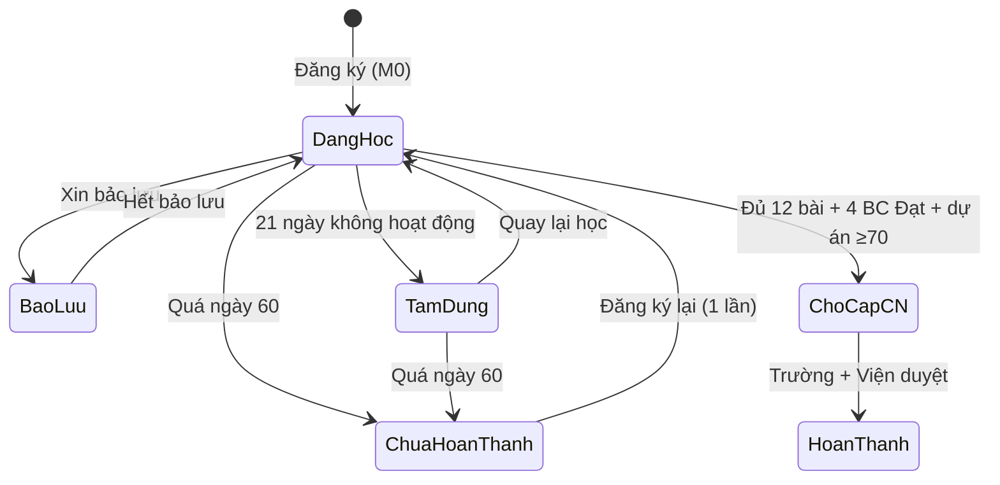

# Thiết kế chương trình học trên Portal AI Campus Tour

> v0.1 (26/10/2026). Đi kèm `PORTAL_PHAC_THAO.md`. Nội dung buổi học lấy từ **Đề cương full chương trình** (12 buổi, nguồn N1–N11).
> Quy ước: **[Tài liệu]** = có trong đề cương · **[Chốt]** = Johnny đã xác nhận · **[Đề xuất]** = Claude đề xuất, cần duyệt.

---

## 0. Kết luận nhanh

- **Cấu trúc 4 tầng:** Chương trình → Module → Bài học → Minh chứng.
- **Lộ trình chính có 6 module:** M0 Khởi động · M1 Nền tảng · M2 Xin việc · M3 Workflow ngành (A/B/C) · M4 Dự án & hồ sơ · M5 Tốt nghiệp.
- **Thời gian:** chuẩn 30 ngày tính từ ngày đăng ký, khoảng **15 giờ học**. Được học nhanh hơn; hạn nộp chỉ là mốc tối đa.
- **Mở khóa:** module sau mở khi SV **đã nộp** báo cáo module trước, **không phải chờ mentor chấm**, để SV không bị kẹt vì tốc độ chấm.
- **Xác nhận có 4 cấp, tất cả do người làm:**
  1. Bài học: SV tự xác nhận + minh chứng bắt buộc, TA kiểm ngẫu nhiên.
  2. Báo cáo module: mentor chấm Đạt/Cần sửa theo tiêu chí cụ thể.
  3. Dự án cuối: mentor chấm rubric 100 điểm.
  4. Chứng nhận: Trường + Viện ĐT Bách Khoa duyệt cấp.
- **Mỗi module có 2 phần bắt buộc:**
  - **Cổng kiến thức**, qua bằng 1 trong 2 cách:
    - **Cách 1:** học các chủ đề tương ứng trong khóa Sự AI (35 chủ đề; video và Zoom cùng nội dung). Hệ thống khóa học tự báo đã qua.
    - **Cách 2:** tự học từ nguồn miễn phí rồi làm trắc nghiệm, hoặc làm thêm bài tập ở module có kỹ năng thao tác.
  - **Sản phẩm thực hành + báo cáo module**: mọi SV đều phải nộp.

---

## 1. Cấu trúc chương trình trên portal

```
Chương trình (Program)
 └─ Module (chặng ~1 tuần)
     └─ Bài học (buổi 45–60')
         ├─ Học      → chọn 1 trong các nguồn (N1–N11)
         ├─ Thực hành → làm ra sản phẩm
         ├─ Phản tư   → AI sai ở đâu, mình sửa thế nào
         └─ Minh chứng → nộp file/link/ảnh/văn bản → tích hoàn thành
     └─ Báo cáo module (gom minh chứng + 5 trường phản tư) → mentor chấm
 └─ Dự án cuối → rubric → chứng nhận
```

### 1.1 Các loại chương trình [Đề xuất]

Portal nên hỗ trợ nhiều loại chương trình ngay từ thiết kế dữ liệu, dù giai đoạn đầu chỉ chạy 1 lộ trình.

| Loại | Ví dụ | Có mentor chấm? | Có chứng nhận đồng cấp? |
|---|---|:-:|:-:|
| **Lộ trình chính** | Lộ trình Ứng dụng AI 30 ngày (khối A/B/C) | ✅ | ✅ |
| **Chuyên đề ngắn** (sau này) | "AI cho Excel trong 5 ngày", "Phỏng vấn với AI" | Không (TA kiểm ngẫu nhiên) | Huy hiệu |
| **Khóa liên kết** | Các khóa Sự AI trên suai.vn / meet.suai.vn | Không (ghi nhận từ bên ngoài) | Không. Chỉ hiện trên hồ sơ |

---

## 2. Lộ trình chính: 6 module

| Module | Ngày (tính từ ngày ĐK) | Bài học | Thời lượng | Đầu ra module | Cách xác nhận |
|---|---|---|---|---|---|
| **M0 · Khởi động** | Ngày 0 | Định hướng, chọn mục tiêu nghề, tự đánh giá đầu vào, cam kết an toàn dữ liệu | 20' | Hồ sơ mục tiêu + bảng tự đánh giá | Tự động khi điền xong |
| **M1 · Nền tảng AI** | 1–7 | Buổi 1, 2, 3 [Tài liệu] + **trắc nghiệm an toàn dữ liệu** | ~3h | AI cá nhân đã cài Instruction + Memory, checklist an toàn | **Báo cáo 1** → mentor |
| **M2 · AI cho xin việc** | 8–14 | Buổi 4, 5, 6 | ~3h | CV, thư xin việc, slide giới thiệu, phỏng vấn thử | **Báo cáo 2** → mentor |
| **M3 · Workflow theo ngành** | 15–21 | Buổi 7, 8, 9 (chọn A/B/C) | ~3h | 1 quy trình chạy được + 1 bước tự động + số đo trước/sau | **Báo cáo 3** → mentor |
| **M4 · Dự án & hồ sơ năng lực** | 22–28 | Buổi 10, 11, 12 | ~3h | Đề bài, bản nháp dự án, portfolio, CV bản cuối | **Báo cáo 4** → mentor |
| **M5 · Tốt nghiệp** | 29–30 | Nộp dự án, bài chia sẻ công khai, 1 đơn ứng tuyển thật | ~3h | Dự án hoàn chỉnh | **Rubric 100 điểm** → mentor |

**Tổng: khoảng 15 giờ trong 30 ngày**, tương đương 2–3 giờ/tuần [Tài liệu].

### 2.1 Vì sao thêm M0 và tách M5 [Đề xuất]

- **M0** ghi lại **trạng thái đầu vào** (SV đang dùng AI ở mức nào, mất bao lâu cho một việc cụ thể). Đến M5, SV có số liệu trước/sau thật để đưa vào CV và rubric (tiêu chí "số liệu trước/sau", 20 điểm). Nhà trường cũng có dữ liệu chứng minh hiệu quả chương trình.
- **M5** tách riêng vì đây là mốc tốt nghiệp, có 3 việc khác hẳn tuần học thường (nộp dự án, đăng bài, ứng tuyển) [Tài liệu].

### 2.2 Chọn khối ngành

- Chọn **tạm** ở M0 (theo ngành học), được đổi tới **trước ngày 15**. Từ khi M3 mở thì khóa lựa chọn.
- Buổi 7–9 hiển thị nội dung theo khối đã chọn. Các buổi khác giống nhau cho mọi khối.

### 2.3 Cổng kiến thức của từng module

Khóa **Ứng dụng AI cho văn phòng** của Sự AI có 35 chủ đề; bản video (Tutor LMS) và bản Zoom (meet.suai.vn) **cùng kiến thức** [Chốt]. Dưới đây là đề xuất chia 35 chủ đề vào các module, bám theo nội dung từng buổi trong đề cương.

| Module | Chủ đề khóa Sự AI (Cách 1) | Cách 2: không học khóa Sự AI |
|---|---|---|
| **M1 · Nền tảng** | **1–11**: Giới thiệu · Làn sóng cắt giảm nhân sự · Ai bị thay thế · Từ chi tiết đến chiến lược · AI làm được gì · AI chưa làm được gì · Nguyên tắc giao việc · Chọn AI nào · Global Instruction · Memory & Chat History · Chọn Model & Effort | Học N2–N5 (Anthropic Academy) → **trắc nghiệm M1** (15 câu, ≥80%) |
| **M2 · Xin việc** | **12–15**: Tab trình duyệt trong Claude · AI trong Excel · AI trên Word · AI trên PowerPoint | Tự học theo hướng dẫn trên portal → **trắc nghiệm M2** (10 câu) + **bài tập thao tác**: ảnh chụp AI chạy trong Excel/Word/PowerPoint (TA duyệt) |
| **M3 · Workflow ngành** (khối A, B) | **16–25**: Tổng quan kiểm soát quy trình & AI agent · Báo cáo với Artifact · Kết nối Gmail/Drive · Schedule · Tách nhỏ agent · Vận hành 3 nhân viên AI · Giải bài tập phần 1–4 | Học N9 + hướng dẫn trên portal → **trắc nghiệm M3** (10 câu) + **bài tập**: 1 agent chạy theo lịch, kèm ảnh cấu hình (TA duyệt) |
| **M3 · khối C (CNTT)** | Khóa Sự AI **không phủ** spec/code/deploy. Chủ đề 16–17 dùng tham khảo | **Mọi SV khối C** làm trắc nghiệm M3-C (dựa trên N11) |
| **M4 · Dự án** (nâng cao, **tùy chọn**) | **26–35**: Skill là gì · Cài skill Anthropic · Plugin · Plugin Data & dashboard · Skill Creator (4 bài) · Plugin Creator · Plugin Trợ lý hành chính | Không bắt buộc. Làm thì được huy hiệu "Nâng cao: Skill/Plugin" |

> M4 để tùy chọn vì đề cương ghi buổi 11 phần Skill/Plugin là "nâng cao (tùy chọn)" [Tài liệu]. Cách chia chủ đề ở trên là đề xuất; đội nội dung cần duyệt lại.

**Quy tắc của cổng kiến thức [Đề xuất]:**

- Cổng **không chặn** việc mở module sau, để SV học Zoom không bị kẹt khi nhân viên chưa kịp xác nhận. Cổng chỉ bắt buộc **trước khi xét chứng nhận**.
- Trắc nghiệm rút ngẫu nhiên từ ngân hàng câu hỏi, được làm lại sau 30 phút, tối đa 3 lần/ngày. Chấm tự động theo đáp án cố định, không dùng AI.
- Hai cách phải **tương đương về công sức**. Cách 2 hoàn toàn miễn phí và **không được khó hơn** Cách 1. Lý do:
  - Đề cương đã chốt khóa Sự AI chỉ là nguồn tùy chọn.
  - Chỉ có 20 suất miễn phí; SV còn lại phải trả phí (giảm 50%).
  - Nếu Cách 2 nặng hơn rõ rệt, trường sẽ thấy portal đang ép mua khóa.
- Portal trình bày hai cách ngang hàng ("Cách 1 / Cách 2"), không gọi Cách 2 là "bài bù".

---

## 3. Mẫu chuẩn của một bài học

Mọi bài theo cùng một khuôn để SV quen nhịp và mentor dễ chấm.

| Khối | Nội dung | Thời gian |
|---|---|---|
| **Mục tiêu** | 1–2 câu: học xong làm được gì | — |
| **Học** | Danh sách nguồn ngang hàng (khóa Sự AI, Anthropic Academy, Microsoft…). SV chọn 1 và đánh dấu đã chọn nguồn nào | 15–25' |
| **Thực hành** | Đề bài tự luyện cụ thể [Tài liệu], kèm ví dụ mẫu đạt chuẩn | 20–30' |
| **Phản tư** | 2 câu bắt buộc: *AI đã sai/thiếu ở đâu?* · *Mình kiểm chứng/sửa thế nào?* | 5' |
| **Minh chứng** | Loại minh chứng quy định riêng cho từng bài (mục 4). Không có minh chứng thì không tích được | — |
| **Lưu ý an toàn** | Nhắc 1 dòng: không đưa dữ liệu cá nhân/công ty/trường vào AI [Tài liệu] | — |

Mỗi bài có **ví dụ minh chứng mẫu** ("bài đạt trông như thế này"). Đây là cách hiệu quả nhất để giảm số bài "Cần sửa".

---

## 4. Minh chứng từng bài và tiêu chí Đạt của báo cáo

### 4.1 Minh chứng bắt buộc theo bài

| Buổi | Sản phẩm [Tài liệu] | Dạng minh chứng trên portal |
|---|---|---|
| 1 | 5 việc của vị trí mong muốn, đánh dấu việc AI làm được | Bảng nhập trực tiếp (5 dòng × cột "AI làm được?") |
| 2 | 3 yêu cầu viết lại trước/sau; 3 lỗi trong 1 câu trả lời AI | Form 3 cặp ô *Trước / Sau* + 3 ô lỗi |
| 3 | Instruction + Memory; checklist 5 điều không đưa cho AI | Ảnh chụp Instruction + checklist đánh dấu |
| 4 | 3 tin tuyển dụng → bảng Excel kỹ năng có/chưa có | File Excel hoặc link Google Sheets + 3 link tin tuyển dụng |
| 5 | CV + thư xin việc cho 1 tin ưu tiên | File/link CV + thư |
| 6 | Slide 5 trang; phỏng vấn thử 15', 3 điểm cần sửa | Link slide + ô 3 điểm rút ra |
| 7 | A: bản nháp nhiệm vụ · B: dữ liệu đã làm sạch/đối chiếu · C: spec + kiến trúc | File/link theo khối |
| 8 | A: báo cáo/slide (Artifact) · B: báo cáo quản trị · C: feature đã code + test | Link Artifact / repo |
| 9 | Bước tự động hóa (A/B) hoặc bản deploy (C); thời gian có/không AI | Ảnh/clip bước tự động hoặc link deploy + 2 ô số phút |
| 10 | Đề bài dự án 1 trang | Form: vấn đề · người dùng · kết quả mong muốn |
| 11 | Dự án chạy được, ảnh trước/sau | Link dự án + 2 ảnh |
| 12 | Portfolio, CV bản cuối | Link portfolio + file CV |

### 4.2 Báo cáo module: tự gom minh chứng [Đề xuất]

Báo cáo tuần **không bắt SV nộp lại file**: portal tự gom 3 minh chứng của 3 buổi trong module. SV chỉ điền thêm 5 trường [Tài liệu]:

1. Bài đã học (tự điền sẵn, kèm nguồn đã chọn)
2. Sản phẩm (tự gom sẵn)
3. AI sai ở đâu & sửa thế nào (gom từ phần phản tư các buổi, SV chỉnh lại)
4. Tổng giờ học
5. Khó khăn cần hỗ trợ (chuyển thẳng sang TA nếu có nội dung)

→ SV đỡ việc, và mentor chấm cả module trên **một màn hình**.

### 4.3 Tiêu chí Đạt cho mentor [Đề xuất]

Mentor tick từng tiêu chí. **Đạt hết thì Đạt**; thiếu tiêu chí nào thì chọn "Cần sửa" và chỉ rõ tiêu chí đó.

| Báo cáo | Tiêu chí Đạt |
|---|---|
| **BC1** | ☐ Bảng 5 việc có đánh giá hợp lý · ☐ 3 cặp yêu cầu, bản "Sau" thể hiện vai trò/bối cảnh/nhiệm vụ/định dạng/tiêu chí · ☐ Chỉ ra ≥1 lỗi thật của AI · ☐ Instruction có thông tin bản thân · ☐ Trắc nghiệm an toàn đạt |
| **BC2** | ☐ CV có ≥3 thành tích nêu bằng số, không bịa · ☐ Thư xin việc nhắm đúng tin đã chọn · ☐ Slide đủ 5 trang · ☐ Có 3 điểm cụ thể rút ra từ phỏng vấn thử |
| **BC3** | ☐ Quy trình mô tả đủ các bước · ☐ Có sản phẩm đầu ra dùng được · ☐ Có 1 bước tự động (hoặc bản deploy với khối C) · ☐ Có số phút trước/sau |
| **BC4** | ☐ Đề bài nêu rõ vấn đề và người dùng · ☐ Bản nháp dự án chạy được · ☐ Portfolio truy cập được · ☐ CV có dòng mô tả dự án |
| **Dự án cuối** | Rubric [Tài liệu]: Giải việc thật, rõ ai dùng (30) · Chạy được, kiểm thử với dữ liệu khác nhau (30) · Kiểm chứng & an toàn dữ liệu (20) · Trình bày, số liệu trước/sau (20). **≥70 Hoàn thành · ≥90 Xuất sắc** |

---

## 5. Hệ thống xác nhận (100% người làm)

| Cấp | Đối tượng | Ai xác nhận | Cơ chế |
|---|---|---|---|
| **0 · Tự động** | M0, trắc nghiệm an toàn | Hệ thống | Trắc nghiệm có đáp án cố định (không dùng AI). Đạt ≥80%, được làm lại |
| **0b · Cổng kiến thức** | Phần kiến thức M1–M3 | Hệ thống khóa Sự AI (video: API; Zoom: nhân viên) **hoặc** trắc nghiệm portal + TA duyệt bài tập | Xem mục 2.3 và 5.1 |
| **1 · Tự xác nhận + minh chứng** | 12 bài học | SV tích; **TA kiểm ngẫu nhiên 10–20%** | Minh chứng không hợp lệ → bỏ tích bài + nhắc nhở; tái phạm → khóa nộp, chờ admin |
| **2 · Mentor chấm** | 4 báo cáo module | Mentor | Checklist tiêu chí Đạt/Cần sửa + nhận xét; hạn phản hồi ≤3 ngày [Đề xuất] |
| **3 · Rubric** | Dự án cuối | Mentor (≥90 thì 2 mentor chấm chéo) | Điểm từng tiêu chí; được sửa 1 lần nếu <70 |
| **4 · Cấp chứng nhận** | Hồ sơ đủ điều kiện | **Trường + Viện ĐT Bách Khoa** [Chốt] | Duyệt theo lô → PDF + QR |

### 5.1 Ghi nhận khóa học bên ngoài

| Nguồn | Cách ghi nhận | Tác dụng trên portal |
|---|---|---|
| **Khóa video Sự AI (Tutor LMS Free)** [Chốt] | Plugin trên suai.vn gọi **API portal** (khớp theo email/mã liên kết) | **Qua cổng kiến thức** của module tương ứng; huy hiệu khi hoàn thành cả khóa |
| **Khóa Zoom (meet.suai.vn)** [Chốt] | **Nhân viên portal xác nhận thủ công**. Nên xác nhận **theo lớp, hàng loạt**: chọn lớp Zoom → chọn phần đã dạy (chủ đề 1–11, 12–15…) → tick các SV đã tham gia | Như trên |
| **Anthropic Academy, Microsoft…** | SV tải chứng chỉ/ảnh hoàn thành (không bắt buộc) | Huy hiệu trên hồ sơ; **vẫn phải làm trắc nghiệm** để qua cổng |

> **Nguyên tắc:** khóa Sự AI giúp **qua cổng kiến thức**, nhưng **không thay sản phẩm thực hành và báo cáo module**. Chứng nhận được cấp vì SV làm ra sản phẩm thật, không phải vì đã xem video. **[Giả định, cần bạn xác nhận]**

#### Vấn đề kỹ thuật: thời điểm khóa video báo "qua"

Bạn mô tả là suai.vn gọi API **khi hoàn thành cả khóa**. Nếu chỉ có tín hiệu này thì SV phải học xong cả 35 chủ đề mới qua được cổng M1, trong khi M1 chỉ kéo dài 7 ngày. Hai cách xử lý:

| Phương án | Cách làm | Đánh giá |
|---|---|---|
| **A. Báo theo từng bài** (khuyến nghị) | Plugin bắt sự kiện hoàn thành **từng bài học** của Tutor (bản Free có hook này, cần kiểm lại tên hook theo phiên bản đang cài) và gửi về portal. Portal tự tính: xong đủ chủ đề 1–11 thì qua cổng M1 | Khớp nhịp từng module. Thêm khoảng 1 hook trong plugin |
| **B. Chỉ báo khi xong cả khóa** | Cổng M1–M3 chờ tới khi khóa hoàn thành mới qua một lượt | Đơn giản, nhưng SV đi Cách 1 thấy "chưa qua" suốt nhiều tuần |

**Nâng độ tin cậy của Cách 1 [Đề xuất]:** trên Tutor, "hoàn thành bài" chỉ là SV bấm nút. Nên thêm **1 quiz ngắn cuối mỗi phần** ngay trong khóa (Tutor Free có quiz), và chỉ coi là "qua" khi quiz đạt. Như vậy hai cách có độ tin cậy tương đương.

### 5.2 Chống gian lận (không dùng AI)

- Phát hiện **trùng file/link** giữa các tài khoản (so mã băm file, so URL).
- Link minh chứng phải mở được; portal kiểm tra tự động link trả về lỗi.
- TA kiểm ngẫu nhiên, ưu tiên các tài khoản tích nhiều bài trong thời gian rất ngắn.
- Mentor có quyền "nghi vấn" một bài → chuyển admin xử lý.

---

## 6. Thời gian và nhịp học

### 6.1 Lịch chuẩn (tính từ ngày đăng ký = ngày 0)

```
Ngày  0   M0 Khởi động
Ngày  1–7   M1 · gợi ý học buổi 1/2/3 vào ngày 2, 4, 6 · hạn BC1 cuối ngày 7
Ngày  8–14  M2 · buổi 4/5/6                          · hạn BC2 cuối ngày 14
Ngày 15–21  M3 · buổi 7/8/9 (A/B/C)                   · hạn BC3 cuối ngày 21
Ngày 22–28  M4 · buổi 10/11/12                        · hạn BC4 cuối ngày 28
Ngày 29–30  M5 · nộp dự án + bài chia sẻ + đơn ứng tuyển · hạn cuối ngày 30
```

### 6.2 Quy tắc mềm dẻo [Đề xuất]

| Tình huống | Quy tắc |
|---|---|
| **Học nhanh** | Được phép. Module sau mở ngay khi đã nộp báo cáo module trước. **Tối thiểu 14 ngày** mới được nộp dự án cuối, để tránh làm ẩu cho xong |
| **Bị "Cần sửa"** | Vẫn học module tiếp song song; sửa trong 7 ngày |
| **Nộp trễ** | Vẫn nộp được, có đánh dấu "trễ"; không trừ điểm, nhưng hiện trên hồ sơ để trường thấy |
| **Gia hạn** | 1 lần, +7 ngày, SV gửi lý do; TA/Admin duyệt |
| **Bảo lưu** | Tối đa 14 ngày (thi, thực tập); đồng hồ dừng |
| **Hạn cứng** | **Ngày 60** tính cả gia hạn và bảo lưu. Quá hạn thì chuyển "Chưa hoàn thành"; được đăng ký lại 1 lần, giữ lại các bài đã Đạt |
| **Không hoạt động** | 7 ngày không tích bài → nhắc [Tài liệu]; 14 ngày → TA liên hệ; 21 ngày → chuyển "Tạm dừng" (không tính vào thống kê đang học của trường) |

### 6.3 Trạng thái của SV



---

## 7. Động lực học (không tốn nhân lực) [Đề xuất]

| Cơ chế | Mô tả |
|---|---|
| **Thanh tiến độ "Ngày N/30"** | Luôn hiện việc tiếp theo cần làm + thời gian ước tính |
| **Huy hiệu module** | M1 "Biết giao việc cho AI" · M2 "Hồ sơ xin việc AI" · M3 "Workflow [ngành]" · M4 "Có dự án thật" |
| **Chuỗi ngày học** | Đếm số tuần liên tiếp học đủ 3 buổi |
| **Thư viện bài mẫu** | Bài Đạt/Xuất sắc của khóa trước (SV đồng ý chia sẻ) làm ví dụ cho người sau |
| **Giờ hỗ trợ trên meet.suai.vn** | 2 buổi/tuần do TA mở; SV đăng ký trước trên portal |
| **Trang so sánh trước/sau** | Đặt kết quả tự đánh giá M0 cạnh kết quả M5. SV thấy mình tiến bộ, trường thấy hiệu quả |

> Không làm bảng xếp hạng công khai giữa các trường, vì dễ gây so bì. Nguyên tắc truyền thông là tránh mọi điều có thể hiểu là chê trường [Tài liệu].

---

## 8. Việc portal cần quản trị được

| Chức năng admin | Lý do |
|---|---|
| Soạn chương trình/module/bài, khuôn bài học, minh chứng, tiêu chí Đạt | Đổi nội dung không phải sửa code |
| **Phiên bản chương trình**: SV giữ phiên bản lúc đăng ký | Sửa bài không làm rối SV đang học |
| Thư viện nguồn N1–N11, gắn nhiều nguồn cho mỗi bài, kiểm tra link định kỳ | Đề cương yêu cầu kiểm lại link |
| Thư viện nhận xét mẫu theo tiêu chí | Mentor chấm nhanh |
| Ngân hàng câu hỏi trắc nghiệm an toàn | Xác nhận tự động cấp 0 |
| Ghi nhận khóa học thủ công (khóa Zoom), xác nhận hàng loạt theo lớp | [Chốt] |
| Cấu hình cổng kiến thức: module ↔ danh sách bài Tutor (ID) ↔ trắc nghiệm/bài tập của Cách 2 | Đổi cách chia chủ đề không phải sửa code |
| Cấu hình quy tắc thời gian (hạn, gia hạn, bảo lưu, hạn cứng) | Điều chỉnh sau đợt chạy đầu |

---

## 9. Lưu ý cần chốt

| # | Vấn đề | Đề xuất |
|---|---|---|
| 1 | Đăng ký tự do [Chốt], nhưng chứng nhận do **Trường + Viện** cấp [Chốt]. Với SV của trường **chưa hợp tác** thì trường đó chưa đồng ý ký | Thêm trạng thái "Chờ trường xác nhận": SV vẫn học bình thường; khi trường ký hợp tác thì cấp theo lô. Hoặc tạm cấp bản chỉ có Viện. **Cần bạn chọn** |
| 2 | Đăng ký tự do làm tăng số SV, và tải chấm tăng theo | Đặt trần số SV mới mỗi tuần, hoặc ưu tiên mentor chấm SV trường đối tác |
| 3 | Lịch tính theo ngày đăng ký, nên hạn "Chủ nhật 23:59" trong đề cương không còn đúng | Sửa đề cương và kịch bản mục 2.6 thành "cuối ngày 7/14/21/28" |
| 4 | Khuôn bài học, tiêu chí Đạt, trắc nghiệm an toàn ở trên là đề xuất | Đội mentor duyệt và chỉnh trước khi nhập lên portal |
| 5 | Có cần kiểm tra đầu vào chặt hơn (bài thực hành nhỏ) thay cho tự đánh giá ở M0? | Giai đoạn đầu dùng tự đánh giá cho nhẹ |
| 6 | SV học khóa Sự AI có **vẫn phải nộp sản phẩm + báo cáo module** không? | Có: khóa chỉ giúp qua cổng kiến thức (mục 5.1) |
| 7 | Plugin suai.vn báo **theo từng bài** hay **chỉ khi xong khóa**? | Theo từng bài (phương án A, mục 5.1) |
| 8 | Thời lượng 35 chủ đề (file khóa học đang để 00:00) | Cần điền để kiểm tra Cách 1 có vừa 2–3 giờ/tuần không. Riêng M3 có 10 chủ đề, dễ quá tải |
| 9 | Cách chia 35 chủ đề vào M1–M4 (mục 2.3) | Đội nội dung duyệt |
