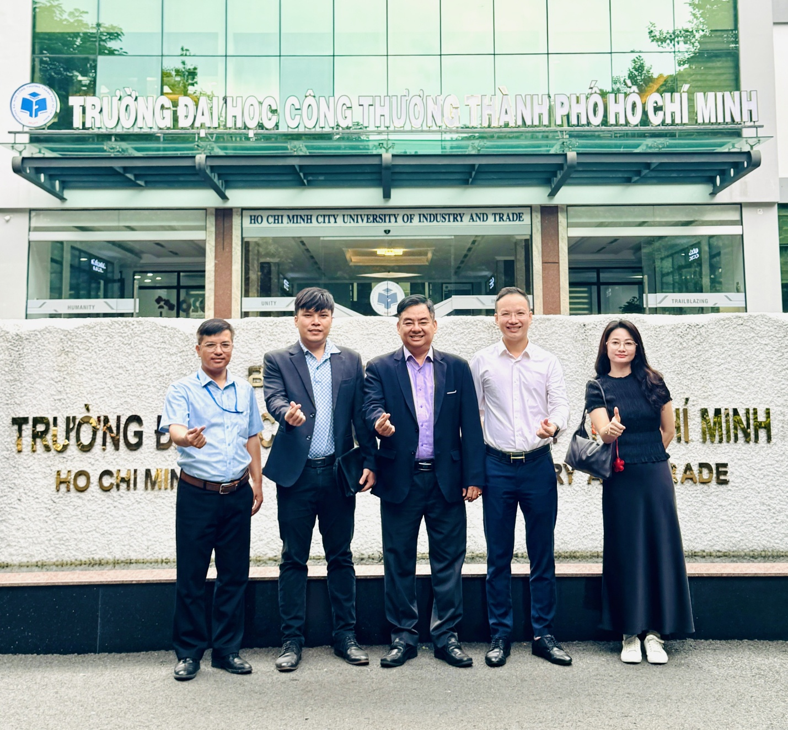
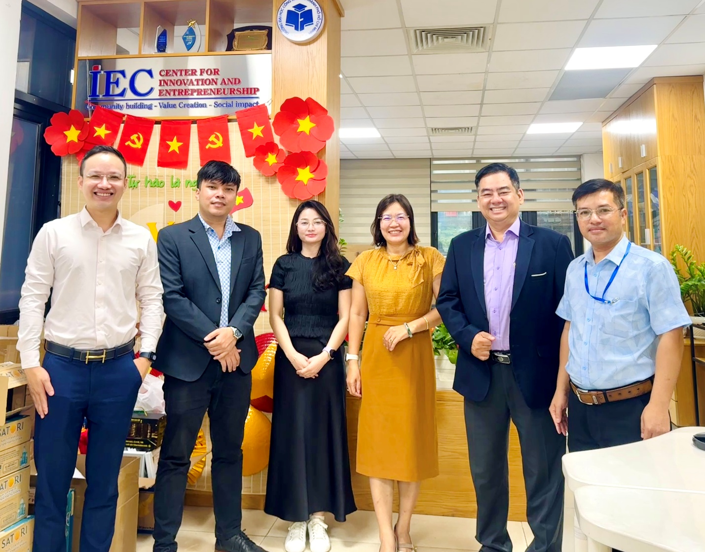
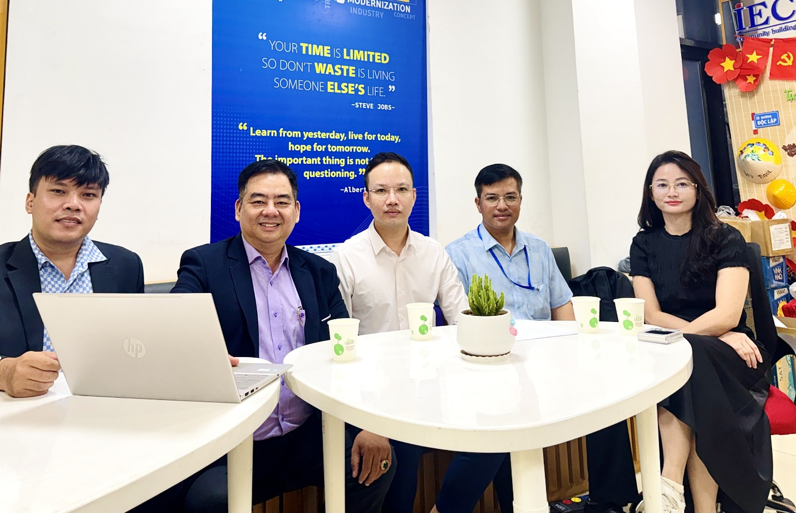

**Sự AI khởi xướng AI Campus Tour – chương trình đào tạo kỹ năng AI cho sinh viên, bắt đầu từ Trường ĐH Công Thương TP.HCM**

*TP.HCM, ngày 12/10/2026, anh Nguyễn Văn Sự (Sự AI) đã có buổi làm việc với **thầy Đặng Xuân Cường, Phó Giám đốc Trung tâm Đổi mới Sáng tạo, Trường Đại học Công Thương TP.HCM**, để khởi động chương trình **AI Campus Tour** tại trường.  
  
**  
Anh Nguyễn Văn Sự - Sự AI (thứ hai từ phải sang) cùng thầy Đặng Xuân Cường (ngoài cùng bên trái) và các đồng sáng lập AI Campus Tour tại Trường Đại học Công Thương TP.HCM.*

AI đang thay đổi nhanh cách doanh nghiệp tuyển dụng và làm việc. Nhà tuyển dụng ngày càng kỳ vọng nhân sự mới biết dùng AI để làm việc nhanh và chính xác hơn. Trong khi đó, phần lớn sinh viên mới dùng AI ở mức hỏi đáp cơ bản và chưa biết cách đưa AI vào một công việc cụ thể.

Từ thực tế đó, Sự AI khởi xướng và sáng lập AI Campus Tour . Đây là workshop **miễn phí** dành cho sinh viên năm cuối, với chủ đề “Kỹ năng AI ứng dụng thực chiến cho sinh viên trước ngưỡng cửa sự nghiệp”. Chương trình không thay thế kiến thức chuyên ngành mà bổ trợ thêm kỹ năng sử dụng công cụ, giúp sinh viên làm việc hiệu quả ngay từ những ngày đầu đi làm.

**“Không thua AI, chỉ thua người biết dùng AI”**

Đây là thông điệp xuyên suốt của workshop. Trong một buổi sáng, sinh viên được đi qua bốn phần nội dung:

- **Bối cảnh thị trường lao động thời AI:** những vị trí đang thay đổi và kỹ năng nhà tuyển dụng cần.

- **Kỹ năng AI nền tảng:** cách giao việc cho AI, kiểm chứng kết quả và giữ tư duy phản biện.

- **Dùng AI để xin việc:** viết CV, thư xin việc, luyện phỏng vấn. Sinh viên cũng được hướng dẫn xây hồ sơ năng lực có sản phẩm AI cụ thể để đưa vào CV.

- **Lộ trình tự học 30 ngày:** sau workshop, sinh viên biết học gì, học ở đâu và tự luyện thế nào.

*  
Anh Nguyễn Văn Sự - Sự AI (Ngoài cùng bên trái) cùng các đồng sáng lập AI Campus Tour chụp ảnh lưu niệm với cô Hoàng Thị Thoa (thứ ba từ phải sang) và thầy Đặng Xuân Cường (ngoài cùng bên phải) tại Trung tâm Đổi mới Sáng tạo.*

Điểm nhấn của chương trình là phần **demo quy trình làm việc với AI theo từng khối ngành**, mô phỏng đúng công việc sinh viên sẽ gặp khi đi làm:

- *Hành chính – Marketing – Kinh doanh:* từ một nhiệm vụ được giao, chia việc cho các AI agent, kiểm tra rồi hoàn thiện sản phẩm để bàn giao.

- *Kế toán – Tài chính – Ngân hàng:* từ một file dữ liệu thô, làm sạch, đối soát, phân tích, rồi tạo báo cáo quản trị bằng AI.

- *Công nghệ thông tin:* từ một yêu cầu, đi qua đặc tả, thiết kế, lập trình, kiểm thử, để có một tính năng chạy được.

Mỗi phần demo đều kết thúc bằng hướng dẫn ghi kỹ năng vừa học vào CV. Workshop cũng dành thời gian nói về đạo đức và rủi ro khi dùng AI: bảo mật dữ liệu, đạo văn và tránh phụ thuộc.

Cuối chương trình là phần tọa đàm, hỏi đáp giữa sinh viên với diễn giả, đại diện doanh nghiệp và bộ phận tuyển dụng. Sinh viên tham dự được nhận chứng nhận và voucher học tiếp một khóa học miễn phí.

**Đội ngũ diễn giả**

Sự AI xây dựng nội dung đào tạo dựa trên kinh nghiệm đào tạo AI ứng dụng cho người đi làm và doanh nghiệp. Cùng đứng lớp với anh Nguyễn Văn Sự là các đồng sáng lập chương trình: TS. Thái Lâm Toàn, Viện trưởng Viện Đào tạo Bách Khoa; anh Nguyễn Thanh Luận, chuyên gia AI trong ngành media; và chị Lê Thị Hồng Nguyên, Giám đốc Công ty AZ Solution. Chi phí tổ chức do nhà trường và các doanh nghiệp đồng hành tài trợ, sinh viên không phải trả bất kỳ khoản phí nào.

**Trường ĐH Công Thương TP.HCM là điểm đến đầu tiên**

Tại buổi làm việc, thầy Đặng Xuân Cường cho biết: *“Thắt chặt mối quan hệ gắn kết chiến lược giữa nhà trường và thị trường lao động thông qua các chuỗi tọa đàm thực tiễn là rất cần thiết đối với Nhà trường, Doanh nghiệp và sinh viên.”*

Anh Nguyễn Văn Sự chia sẻ: *“Chúng ta không thua AI, mà chỉ thua người biết dùng AI. Chúng tôi muốn các bạn bước ra khỏi giảng đường với những kỹ năng có thể dùng ngay trong ngày đầu đi làm. Cảm ơn nhà trường và Trung tâm Đổi mới Sáng tạo đã tạo điều kiện để chương trình bắt đầu từ đây.”  
*  
*Anh Nguyễn Văn Sự - Sự AI (giữa) cùng các đồng sáng lập AI Campus Tour làm việc với thầy Đặng Xuân Cường (thứ hai từ phải sang) tại Trung tâm Đổi mới Sáng tạo.*

**Lộ trình tiếp theo**

Buổi workshop đầu tiên tại ĐH Công Thương TP.HCM dự kiến đón 300–500 sinh viên. Sau đó, chương trình hướng tới 15–20 trường đại học mỗi năm, với nội dung được chuẩn hóa để chất lượng đồng đều ở mỗi trường.

Doanh nghiệp muốn đồng hành cùng chương trình, qua hình thức tài trợ, kết nối tuyển dụng hoặc cử chuyên gia chia sẻ, có thể liên hệ qua số điện thoại 0985850122.

Hoặc truy cập website[: https://www.suai.vn/khoi-dong-ai-campus-tour-dua-ky-nang-ai-thuc-chien-den-sinh-vien-nam-cuoi/](:%20https://www.suai.vn/khoi-dong-ai-campus-tour-dua-ky-nang-ai-thuc-chien-den-sinh-vien-nam-cuoi/%20)  
<http://suai.vn>
